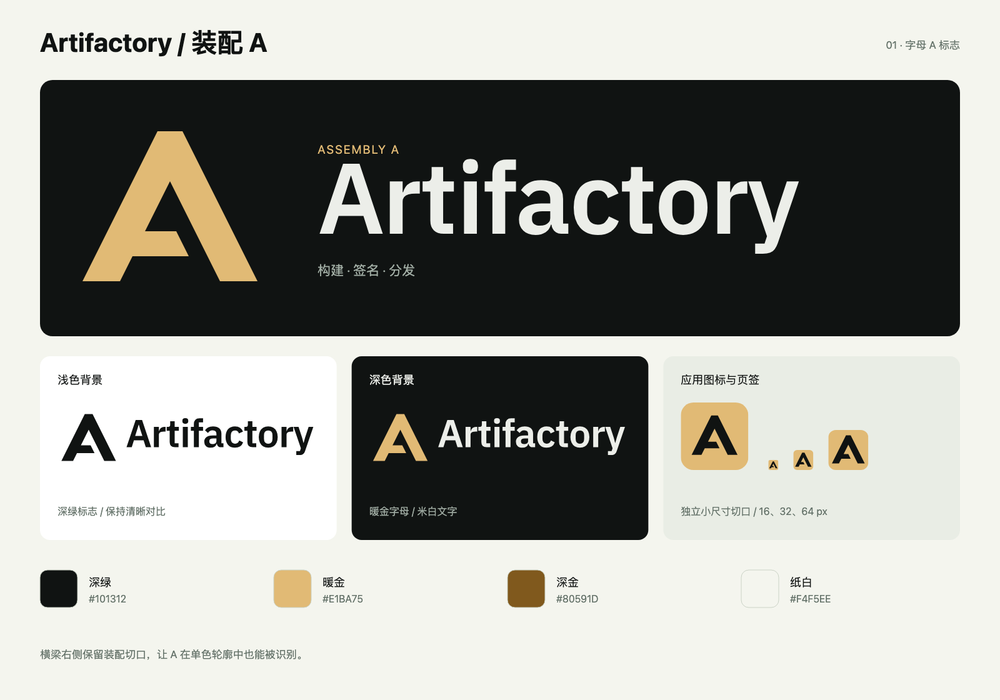

# Artifactory · 装配 A

2026-11-12 选定第 1 款「装配 A」。平顶大写 A 的横梁右侧保留装配切口，表达构建与连接。

[完整 Logo 文件包](artifactory-logo-kit.zip) 包含 SVG、透明 PNG、字体许可、深浅色图文组合、favicon、应用图标、展示板与使用说明。

## 仓库中的文件

| 用途 | 文件 |
|---|---|
| 页面中的 A 符号 | `web/src/components/brand-mark.tsx` |
| 标准符号与图文组合 | `web/public/brand/*.svg` |
| 浏览器图标 | `web/src/app/icon.svg`、`web/src/app/favicon.ico` |
| Apple 主屏幕图标 | `web/src/app/apple-icon.png` |
| 应用清单 | `web/src/app/manifest.webmanifest` |
| 清单引用的图标 | `web/public/icon-192.png`、`icon-512.png`、`maskable-512.png` |

SVG 图文组合中的文字已转为路径，不依赖安装字体。字标基于 IBM Plex Sans 600，调整字距后轮廓化；SIL Open Font License 1.1 见 [字体许可](IBM-Plex-Sans-OFL.txt)。

## 配色与使用

| 名称 | HEX | 用途 |
|---|---|---|
| 深绿 | `#101312` | 浅底标志、图标中的 A |
| 暖金 | `#E1BA75` | 深底符号、应用图标底色 |
| 深金 | `#80591D` | 浅底上的金色替代 |
| 纸白 | `#F4F5EE` | 浅底背景 |
| 米白 | `#ECEEE9` | 深底文字 |

浅色页面使用 `artifactory-horizontal.svg`，深色页面使用 `artifactory-horizontal-dark.svg`。纯黑与反白版本以 `-black.svg`、`-white.svg` 结尾。暖金配深绿的对比度约 10.22:1，深绿配纸白约 17.03:1。

外围留白至少等于一个横梁高度，即 256 单位原图中的 32 单位。标准符号最小使用 24 px；16 px 使用专门的小尺寸符号或 favicon。横向、上下图文组合最小使用 160 px 宽。保持原始比例、切口、角度和图文间距。

标准图形横梁右侧的水平间隙为 24 单位，小尺寸版本扩大到 32 单位；反白版本略减薄笔画。页面品牌标志使用小尺寸绘制，登录页、注册页和侧栏共享同一个组件。Next.js 按文件约定自动生成图标和清单的元数据链接。
