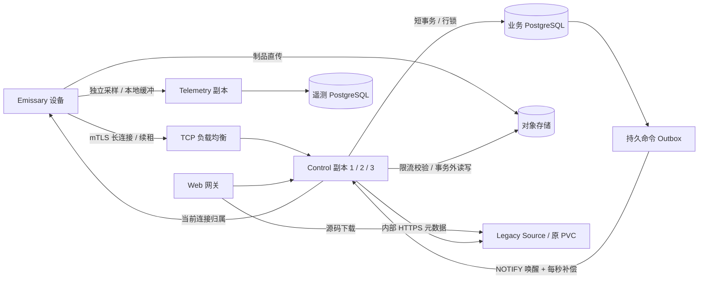

# Control 多副本与设备容量

本次实现已在三个实际 Control 进程上通过 10,000 条 mTLS 设备连接、1,000 个活动执行租约的故障压测，采用 PostgreSQL Outbox、NOTIFY 和定时补偿，无新增消息中间件。HA 配置每进程 40 条数据库连接；心跳 P99 768.37 ms、API P95 304.80 ms，全部 6,667 次重连在 20 秒预算内完成，期间有 247 次可恢复 RPC 重试。测试使用虚拟执行器，真实构建吞吐与生产容量仍需独立验收；详见 [验收报告](acceptance/control-ha/2026-11-14.md)。

## 数据流与故障语义



调度按到期的 queued job 查询匹配节点，每轮最多 64 个任务。节点锁与锁后的新快照检查约束 slots，任务和命令在同一事务提交。调度不遍历所有空闲连接，不重复更新历史终态 Build。暂时没有匹配节点的任务延后 5 秒，防止不兼容平台堵塞后面的队列。

设备平台索引仅包含池、OS 和架构，不包含每次心跳都变化的 `last_seen`；节点表使用 80% fillfactor，为 PostgreSQL HOT 更新预留页内空间，减少心跳产生的索引和 WAL 写入。在线与证书时效仍在调度时按当前时间检查。已有页的空闲空间随正常更新逐步形成，本次迁移不重写整张节点表。

每个 Control 启动生成独立 UUID，节点保存当前 session 和连接归属。新会话的数据库初始化并发不超过每副本连接池的一半，最多 16 个，默认 20 条连接时为 10 个，HA 示例 40 条连接时为 16 个；覆盖证书匹配、替换 session 和首个 hello。登记使用一次有条件 UPDATE，同时核对 hello 的节点 ID、实际 mTLS 证书摘要、撤销和有效期，并写入 session、归属及首个健康快照，减少重连的数据库往返。其他请求先等待准入，不让重连突发耗尽已有设备续租的连接池。命令表只保存节点、attempt、类型等引用，不保存凭据或整个构建计划。发送时重建 assignment；只有连接归属匹配的副本才能投递。Source 元数据复用进程内 HTTP 连接池，assignment 准备最多并发 8 个，并在独立循环运行，慢 Source 不阻塞取消、租约回收和后续任务调度；准备完成后再次检查会话、归属、授权和取消状态。队列满或连接中断会重放同一 command ID、attempt ID 和 lease token。socket 写成功不算执行确认；accept 将 attempt 置为 running 后停止 assign 重放，终态确认 cancel。7 天前已确认命令按每批 1,000 条回收。

普通心跳的 `last_seen`、能力、诊断和普通 OTA 健康状态是可覆盖快照，单条更新使用事务内的 `synchronous_commit=off`，减少逐台等待 WAL 同步。数据库崩溃可能丢失最近尚未刷盘的健康样本，设备会在后续心跳补齐。新 session/归属注册、执行租约、命令、取消及具体 OTA 升级状态继续使用数据库配置的提交策略；生产业务库应保留同步提交和 fsync。设置在当前语句的隐式事务结束时恢复，不影响连接池后续事务。语义见 [PostgreSQL 异步提交说明](https://www.postgresql.org/docs/17/wal-async-commit.html)。

空闲设备的普通心跳只执行这一次有条件更新，直接复用其授权结果发送健康确认，避免再读一次节点。过期、撤销或被替换的 session 更新不到行，连接随即关闭。携带活动执行或具体 OTA 状态时，后续各自的事务仍重新核验授权与租约。

LISTEN/NOTIFY 只负责加速唤醒。所有工作触发器通过非阻塞的事务 advisory lock 合并并发通知，避免 PostgreSQL 的全局通知锁将业务提交串行化。未取得锁的事务仍提交业务状态与命令；通知可能早于这些事务可见，数据库提交后的命令表和每秒补偿负责恢复，通知丢失不会丢任务。连接和工作通知只唤醒任务调度与命令投递；OTA 检查及全局维护在独立循环中按每秒固定节奏执行，跳过错过的周期，避免重连反复触发全库维护。维护使用跨副本 advisory lock，单个 Build 的维护锁等待不阻塞新任务调度。重复投递由现有 Emissary 状态机与 lease fencing 处理。正在运行的任务续租跨副本有效；运行后租约过期保留为 lost，需要显式重试，不自动重新执行。

SIGTERM 先令 `/readyz` 返回 503，停止新会话和本地调度，并以每批 64 条、跳过忙节点的短提交清除本进程的数据库连接归属，避免一个行锁阻塞整批设备；现有会话在传播窗口内仍可续租。等待 drainSeconds 后关闭流，设备带抖动重新连接。其他副本不会继续给已清除归属的旧连接派新任务。`/healthz` 保持进程存活检查，`/readyz` 还检查数据库可用性。

## 为什么暂时不引入 MQ

构建状态、租约、取消与排队已经在 PostgreSQL 中。Outbox 将命令和状态一起提交，避免另一个消息系统与业务库之间的双写一致性问题。当前不依赖 Redis、RabbitMQ、Kafka 或 NATS。

当实测显示命令分发吞吐持续超出数据库预算，或需要跨区域、独立设备接入层、多个独立消费者时，再将 Outbox 发布到 NATS JetStream / RabbitMQ 等系统。届时仍需保持 Outbox、执行幂等和租约校验，不能用消息 ACK 代替执行状态。高频指标继续走独立 Telemetry，不进入控制命令队列。

## 存储和连接预算

制品 S3 GET、完整摘要校验与最终 PUT 均在业务事务之外。每副本有独立校验 semaphore，校验结束后以短事务重新检查节点、租约、取消状态及不可变声明，再写入唯一 artifact。并发相同声明只生成一条记录；校验期间过期或被取消的执行不能提交产物。

日志复用一条独立于控制长流的 mTLS channel，失败后由本地 spool 重试；不再每批新建 TLS 连接。设备重连、遥测失败重试和采样初始相位都有抖动。普通 OTA 健康上报只锁节点，只有具体升级任务上报参与池级序列化。

| 设置 | 默认 | 范围 / 用途 |
| --- | --- | --- |
| `ARTIFACTORY_DB_MAX_CONNECTIONS` | 20 | 每个 Control / Source 进程 8–256；包括一条 LISTEN 连接 |
| `ARTIFACTORY_ARTIFACT_VERIFY_CONCURRENCY` | 4 | 每副本 1–32 |
| `ARTIFACTORY_SCHEDULER_BATCH_SIZE` | 64 | 每轮 1–256 |
| `ARTIFACTORY_CONTROL_DRAIN_SECONDS` | 5 | 1–30 秒 |
| `ARTIFACTORY_LOCAL_SOURCE_URL` | 空 | 开启独立 legacy Source；内部地址需 HTTPS |
| `ARTIFACTORY_EMISSARY_RELEASE_SOURCE` | 数据目录下的文件 | 所有副本读取相同的 OTA 仓库及可信公钥配置 |
| `ARTIFACTORY_TELEMETRY_WRITE_CONNECTIONS` | 12 | 每遥测副本 2–128 |
| `ARTIFACTORY_TELEMETRY_READ_CONNECTIONS` | 4 | 每遥测副本 2–128，可配置只读数据库地址 |
| `ARTIFACTORY_TELEMETRY_AUTH_CONNECTIONS` | 4 | 每遥测副本读取业务授权库的连接数，2–128 |

连接预算按同一 PostgreSQL **实例**合计，而非按数据库分别计算。示例 HA 在滚动升级期间最多 4 个 Control，加 1 个 Source、2 个 Telemetry：业务连接上限为 `4×40+40+2×4=208`，遥测连接为 `2×(12+4)=32`，还需预留运维和其他服务连接。Kubernetes 终止中的 Pod 还可能与后续更新步骤重叠；按最多 6 个 Control、1 个 Source、4 个 Telemetry 预留时，上限为 `6×40+40+4×(12+4+4)=360`。`values-ha.yaml` 将 Control / Source 连接池设置为 40，内置数据库上限设置为 450，并提供 Control 2 GiB、数据库 4 GiB 内存限制示例。压测数据库运行在约 15.66 GiB 的 Docker VM 中，容器没有独立内存限制，`shared_buffers=4009MB`，因此本次未验证该 4 GiB 数据库限制的容量；应依据实测的连接等待与工作集调整，并预留续租和运维容量。提高上限不能替代 SQL、WAL 与 I/O 的优化。生产建议使用外部 HA PostgreSQL，并将遥测放到独立实例，避免 WAL、I/O 与自动维护争用。当前 LISTEN 和业务连接共用 `DATABASE_URL`，该地址应直连 PostgreSQL 或使用支持会话语义的 session pooling；不能将整个 Control 连接到 PgBouncer transaction pooling 端点。

Control 的 `temporaryStorage` 默认 10Gi，实际应大于“校验并发 × 最大制品大小”并预留余量；同一个制品的重复完成请求也会占用校验预算。临时盘不足会令校验失败，不能将 emptyDir 当作持久制品库。最终制品和日志由共享对象存储保存。

## Helm 部署与已有 PVC 迁移

默认仍兼容原来的单副本部署。启用 `localSource.enabled=true` 后，Control 使用独立 emptyDir 和 RollingUpdate，`serve-source` 以单副本 Recreate 独占原 `<release>-control` PVC。网关直接将 `/api/v1/source/*` 流量转发到 Source，不经 Control 转发源码字节。此兼容 Source 仍是源码解析/下载的单点；它不可用时源码相关操作会失败，尚未完成的源码下载会受影响，设备续租和正在执行的步骤可继续。新的 Kubernetes Runtime / Source 后端保持原有路由和恢复机制。

首次切换必须在维护窗口分阶段完成，避免两个进程同时写原 RWO 卷：

1. 备份业务库、对象存储、原 control PVC、master key、CA 与 OTA 信任配置。停止创建新构建，等待活动构建结束，记录原 Helm values、镜像和源码路由。
2. 使用原 values 将 `control.replicas` 改为 0，等待原 Control Pod 完全退出。不要只等待 Deployment 发出滚动更新事件。
3. 用原 CA 为服务器证书补充 `<release>-local-source`、`<release>-local-source.<namespace>.svc` SAN，更新原 PKI Secret。新版 `init-helm.py` 的新安装包含这些 SAN；已有安装不得重新初始化 CA 或 master key。
4. 用同一版本镜像开启 `localSource.enabled=true`，暂时保持 `control.replicas=0`。确认 Source 挂载原卷、内部 HTTPS 正常，原 snapshot ID 和下载地址不变。将原 OTA 配置制作为所有副本可读的 ConfigMap，并设置 `control.releaseSourceConfigMap`；文件中只放仓库及可信公钥，凭据继续使用 Secret。
5. 合并原环境配置和 `charts/artifactory/values-ha.yaml`，将 Control 设置为 3 副本。确认每副本独立 emptyDir、数据库预算、PDB、反亲和性和 45 秒终止窗口。验证真实登录、跨副本重连、旧 snapshot 下载、制品完成和 OTA 导入后再开放创建构建。

上述升级命令需要由部署负责人针对实际 context、namespace 和 release 执行。本实现没有修改任何已有安装。

新建安装可以直接合并 HA overlay。外部 HA 存储使用 `postgres.enabled=false`、`s3.enabled=false`，将现有凭据 Secret 中的业务与遥测数据库 URL 指向对应服务，填写 `s3.endpoint` 和 `s3.publicEndpoint`。Chart 会停止创建相应 Deployment、Service、PVC 及内置 S3 Ingress。保留已存在的卷并显式执行数据迁移，不能只改 URL 后让业务连接到空库。

Control 三副本解决 Control 进程故障。默认 Web 网关、内置数据库、内置 S3、兼容 Source 的单副本仍有各自可用性边界；完整平台 HA 还需要外部存储、入口多副本和跨故障域部署。

## 查询契约

`GET /api/v1/nodes` 保持 JSON 数组响应，默认最多 100 条；支持 `limit=1..500`、`offset=0..10000000`、最长 100 字节的 `q`。搜索匹配设备名、OS、池名，排序为 created_at 与 ID 倒序。Web 已使用服务端分页和搜索；总注册数由 overview 的 `nodes_registered` 提供。旧客户端需要分页，不能再假定一次返回全部设备。offset 翻页在并发注册时可能移动，严格库存导出应在固定快照下读取。

规划上下文将同池、平台、标签、能力、签名授权与工具版本的设备聚合，最多 128 类、序列化后最多 128 KiB，保留 count、online_count、tools、total_groups 和 truncated。单类详情超过 8 KiB 时保留平台与数量，省略标签、能力、签名授权和工具详情并标记 `details_omitted=true`。超过总预算时保留排在前面的类别，并显式标记截断。模型可识别信息缺失，不能据此假定未出现的平台或工具不存在。

## 回归与压测

`tests/control/load.py` 使用独立测试库中的随机 schema，启动三个真实 Control 子进程、独立目录和 mTLS 设备连接。默认每个 Control 使用 20 条数据库连接；HA 预算可通过 `--database-connections 40` 复现。测试数据库连接上限需覆盖三个连接池与测试端连接，例如 HA 档使用 200。默认 1,000 在线 / 100 活动，可用 `--nodes 5000 --active 500`、`--nodes 10000 --active 1000` 升档。测试先等待指定活动执行数，再按 10 秒周期心跳，强杀一个进程、对另一个发送 SIGTERM，验证连接恢复、attempt ID 不变、无 lease 取消。每档采集 API P95、心跳 P99、正常/强杀/排空三个阶段的延迟、连接恢复延迟、样本数、连接重试、数据库连接与锁等待峰值，以及最终幸存进程的 RSS / CPU 快照。

```sh
export ARTIFACTORY_TEST_DATABASE_URL='<disposable TimescaleDB URL>'
python3 tests/control/load.py --release --nodes 1000 --active 100 --seconds 60
python3 tests/control/load.py --release --nodes 10000 --active 1000 --seconds 60 \
  --database-connections 40
```

若 macOS 上 Rust 1.95 的 release 过程宏出现 `mis-aligned LINKEDIT string pool`，可加 `--cargo-config 'profile.release.build-override.strip="none"'`，只关闭构建工具/过程宏的符号剥离，保留目标程序的 release 优化。证据会记录该覆盖。

证据保存在 `.local/control-load/<timestamp>-<nodes>-<active>/evidence.json`，另有运行日志和经过 URL 过滤的 Control 日志。临时 schema 与进程在成功后清理；失败日志用于定位测试端与服务端问题。压测使用虚拟执行器和受控 S3 peer，覆盖控制连接与执行租约，不包括真实编译、制品吞吐、SSE 浏览人数或遥测采集吞吐；CPU 是单次快照，RSS 不是峰值。debug 构建、本机网络与共享开发机结果不构成生产 SLO。

数据库回归另覆盖事务回滚不发命令、队列满后重放、running/终态确认、跨构建 slots 竞争、取消和 OTA 排空、不兼容队列前缀、公钥/会话隐藏、分页及万台设备能力摘要。真实 mTLS 回归覆盖副本切换和 21 个等待慢 S3 的完成请求（20 个声明、1 个重复请求）：验证校验并发为 4，续租和 readiness 持续成功，最终只有 20 条 artifact；另验证校验等待期间被取消的请求不能提交制品。Source 回归使用实际独立 HTTPS 进程和旧快照，在持有 Source 缓存锁时确认 Control 仍可投递取消、回收租约并调度其他任务。

Emissary 回归运行真实进程并注入一次日志 RPC 失败，断言所有日志从 spool 恢复且不重复，多个上传批次只使用控制流与日志各一条 TLS 连接。

## 运维观察与回退

重点观察最老未确认命令年龄、queued job 等待、租约续约分位数、重连率、数据库池等待、锁等待/WAL、校验队列和临时盘、遥测积压。重连期间的已开始任务应保留原 attempt；数据库中断超过租约窗口仍可能产生 lost，不能以恢复连接代替执行验收。

临时使用 `RUST_LOG=artifactory_control=debug` 可记录新连接的 `admission_ms`、`identity_ms`、`session_ms` 和 `hello_ms`，分别定位准入等待、证书身份提取、有条件授权与会话写入、首个报告处理。压测可通过 `ARTIFACTORY_LOAD_LOG` 将过滤器传入测试子进程；默认保持 warn。

回退优先保留新版本，缩至单副本并保留独立 Source。若要恢复原卷一体部署，先停止所有 Control 和 Source，再将唯一 Control 重新挂载原 PVC；不得在 Source 存活时挂回同一卷。迁移 0012 增加的表、列、触发器可以保留，**不能直接运行旧二进制并让新旧调度器混跑**：旧调度器不识别 Outbox 与连接归属。降级二进制需要停机、核对旧版 sqlx migration 校验，并按备份恢复方案执行。
