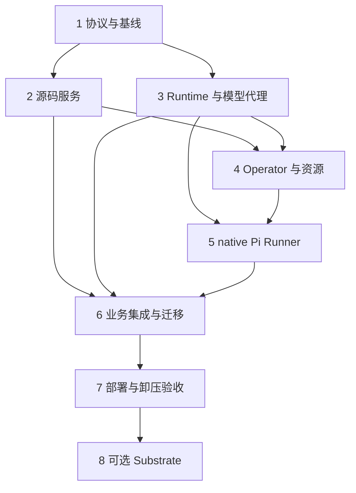

# Kubernetes Agent Operator 落地计划

> 2026-11-13 后续决策：设备执行器已更名为 **Artifactory Emissary**，由 Rust 完全替换，不保留 Go 接入、旧协议别名或迁移层。下文的 Go / 混合机群描述保留为首期计划历史，不作为当前实施要求；当前实现与验证见 [Emissary 记录](../acceptance/emissary/2026-11-13.md)。Pi 与设备执行器的职责划分不变。

**交付目标：native 在 Kubernetes Job/Pod 上运行 Pi，Rust Operator 管理运行与源码处理资源，Rust Runtime/Source 服务接管高频执行和源码数据流；Substrate 可选，业务控制平面继续接纳计划和调度设备 Agent。设备 Artifactory Agent 后续迁移到 Rust。**

首期单元 1—7 已完成。2026-11-12 用户确认“只要验证流程即可”，本轮以完整业务与故障流程验证收口；500/1,000 活动实例列入后续容量验证。Rust Operator、Runtime/Source、Kubernetes Pi、控制平面接纳及现有 Go 设备构建已连通，最终流程 22 项检查与 kubelet 不可达时的取消清理复验通过，详见[本次验收记录](../acceptance/operator/2026-11-12.md)。同负载基线、冷启动网络隔离、独立数据服务恢复、100 活动及 10,000 排队已有实测证据。下文区分本轮结果与生产容量、灾备和其他平台的后续验证；单元 8 与 Rust 设备 Agent 重写不属于首期交付。

架构依据为[设计文档](../superpowers/specs/2026-11-12-kubernetes-agent-operator-design.md)，上游依据为[Substrate / AX 评估](../substrate-scheduling-assessment-2026-11-12.md)。目标仓库为 artifact-kit；文件路径相对仓库根目录。实际采用 migration `0010_runtime_intents.sql`，各服务及 Operator 测试按职责合并至对应 package，具体路径以仓库现状为准。

## 问题与决策

现有 Pi Worker 已有 Helm Deployment，但工具、Git/LFS 下载、快照校验、租约和模型预算都依赖业务控制服务。直接容器化不能消除这些热路径。Operator 首期分出职责并兼容现有 Go Agent；设备 Agent 的 Rust 重写作为后续独立阶段。Pi 沿用上游 Node.js/TypeScript 运行时，设备端仍执行实际构建和签名。

| 决策 | 原因与代价 |
| --- | --- |
| Operator 用独立 Rust package，加入根 Cargo workspace | 采用 kube-rs/kube-runtime，与控制平面及数据服务统一工具链；独立镜像/发布，可按需拆仓库 |
| native Job，Substrate Actor，公共运行协议 | 保留两种选择，避免两套预算与结果语义 |
| Source Service 复用 Rust Git/LFS/快照逻辑 | 保护现有 submodule、历史快照和权限规则；需要先解开 AppState/业务表耦合 |
| Runtime 与模型代理先合并为一个服务 | 单一调用预留 authority，减少首期服务数量；其数据库仍需独立容量观测 |
| 四个 CRD，排队和大数据在专属数据库/对象存储 | 限制 etcd 和 reconcile 压力；增加跨服务幂等交接工作 |
| native 交付后再接 Substrate，AX 延后 | 第一批卸压收益不依赖外部 Actor 平台安装和 alpha API |
| 设备 Artifactory Agent 后续迁移 Rust | 保留 protobuf/gRPC/mTLS 合同，Go/Rust 设备混合接入，按平台灰度替换；独立于 Operator 首期验收 |

## 要求追踪与交付门槛

| 设计要求 | 实施单元 | 通过证据 |
| --- | --- | --- |
| R1/R2：Kubernetes native 与独立 Operator | 1、4、5 | 无 Substrate 集群上完成一次真实规划，得到被接纳的计划 |
| R3：业务与 Go 节点调度兼容 | 1、6、7 | 同一计划可继续派发已有 Go Agent；平台/签名与修订约束回归 |
| R4：源码数据面卸载 | 2、6、7 | 源码服务直接传输，业务控制服务无 Git 子进程/源码带宽 |
| R5：执行热路径卸载 | 3、5、6 | 新 native 的心跳/模型预留/检查点不进入业务热表 |
| R6/R7：幂等、fencing、预算与取消 | 1、3、4、5、6 | 重复 Pod、未知创建结果、取消并发和确认丢失均无重复业务接纳 |
| R8：有界准入与 Kubernetes API 负载 | 3、4、7 | 大排队量不产生同量 Pod/CRD；status 更新与阶段变化相关 |
| R9：迁移、回退与收益验证 | 1、6、7 | 分阶段基线/灰度/回退记录，保留预算与固定源码 |
| R1 的可选 Substrate | 8 | 单独开关、相同协议验收；关闭后 native 独立完成业务 |

单元 1—7 构成 native 首期；单元 8 为独立可选增量。Pod 启动成功只通过承载验证，不能据此通过卸压和业务验收。

## 技术关系与依赖

下面是实施依赖示意，具体模块边界以设计文档为准，不是待复制的实现代码。

## 实施单元

- [x] **单元 1：协议、权威状态与基线**

  **实施记录：** 协议、三个独立 authority、事务 outbox、版本与幂等/fencing 已实现且回归通过。同一个固定 8 MiB 数据集、4 并发和 60 秒模型等待的 Poll/Kubernetes 对照已通过，采集业务 P95、CPU/RSS/网络、三库活动和源码字节；只在同一个存活 Pod UID 内计算资源差值。首次有效证据为 `.local/operator-load/20261112-184744-compare/evidence.json`；本地试验 SLO 为 overview P95 < 1 秒且无错误，生产 SLO 单独审阅。

  **目标/要求：** 把 R1—R9 的跨服务边界固定成可演进合同，并保留当前行为的基线。无前置依赖。

  **文件：** Create `proto/artifactory/runtime/v1/runtime.proto`、`docs/runtime-protocol.md`、`crates/control/src/runtime_bridge.rs`、下一号 `crates/control/migrations/NNNN_runtime_intents.sql`、`crates/control/tests/runtime_intents.rs`。Modify `proto/artifactory/agent/v1/agent.proto`（仅必要的兼容引用）、`crates/control/src/api/builds.rs`、`crates/control/src/api/ai_management.rs`、`crates/control/src/settings.rs`。

  **做法：** 明确 run/attempt/UID、幂等 ID、内容 hash、aggregate version、错误分类、cancel/accept ack 和源码保留合同；定义 business/runtime/source 三个 authority。将 intent/outbox 与 Build 操作放入同一短事务。固定 API group、协议版本策略、kube-rs/k8s-openapi/Rust/Kubernetes 与镜像兼容矩阵。保留设备 Agent protobuf 的跨语言兼容边界，记录现有 Poll、调用预算、600 秒 deadline、clarify、新修订与节点匹配的语义。

  **执行方式：** 先做现有行为的特征测试和基线记录，再迁移；不把可观察差异直接认作预期行为。

  **测试场景：** 正常创建 Build 只产生一个意图；重投相同 ID/内容幂等；相同 ID/不同 hash 拒绝；取消事件先于创建到达不能复活运行；事务中断不出现有 Build 无意图；旧版客户端未知可选字段仍兼容；缺失 snapshot/profile/pool 不得生成可执行意图。

  **验收：** 协议文档列出每类数据唯一写入者、重试和失败边界；可在既有实现上采集业务 API、Git/带宽、PG 连接/锁、Pi 心跳/模型调用的基线，记录数据集、并发、时长和环境。

- [x] **单元 2：抽取 Source Service、快照持久化与确定性分析**

  **目标/要求：** R2/R4/R6/R7，将源码 CPU/I/O 与长传输保护移出业务控制进程。依赖单元 1。

  **文件：** Create `crates/source-core/`、`crates/source-service/`、`crates/source-service/migrations/`、`crates/source-service/tests/snapshots.rs`、`crates/source-service/tests/access_and_retention.rs`、`crates/source-service/tests/tools.rs`。Modify `Cargo.toml`、`crates/control/src/source_cache.rs`、`crates/control/src/source_cache/refs.rs`、`crates/control/src/api/source_http.rs`、`crates/control/src/source.rs`、`crates/control/src/storage.rs`；保留并扩展 `crates/control/tests/fixtures/source_http.py`、`crates/control/tests/database/source_refs.rs`。

  **做法：** 从 AppState 中拆出 Git/LFS/manifest/tool 库；Source Service 独立元数据/连接池和缓存目录。按授权域/仓库锁串行更新，仓库间并行。引入不可变对象包、分析版本、分片路由、读保护、保留/GC 协议与凭据 broker。先以服务客户端替代控制进程内部源码调用；网络路径切换在单元 6 执行。

  **执行方式：** 用相同固定快照对新旧实现做特征对照，优先保留正确性；无需首期重写搜索算法。

  **测试场景：** branch 移动后重试仍读原 commit；tag、嵌套 submodule、LFS 与旧快照精确恢复；空仓库/缺失 ref/缺失 LFS 不伪装完整；同仓库并发 fetch 合并、不同仓库并行；跨项目/凭据版本不可借缓存越权；等待缓存锁后 attempt 已取消则拒绝；大文件/搜索/分页限制一致；读期间/在途保留/Release 引用阻止 GC；引用权威不可达时不删除；PVC 丢失从持久对象恢复，缺失对象明确失败。

  **验收：** 快照、工具和 Git/LFS 协议对照通过，控制进程可在不执行 Git 的情况下获取固定源码和证据核验结果；长下载不占用业务 PG 长事务。Source 数据库和备份可独立恢复。

- [x] **单元 3：Runtime Gateway、预算与模型代理**

  **目标/要求：** R5/R6/R7/R8，持久化运行队列、fencing 和唯一预算预留。依赖单元 1。

  **文件：** Create `crates/planner-runtime/`、`crates/planner-runtime/migrations/`、`crates/planner-runtime/tests/leases_and_fencing.rs`、`crates/planner-runtime/tests/model_budget.rs`、`crates/planner-runtime/tests/outbox.rs`。Modify `Cargo.toml`、`crates/control/src/planning.rs`、`crates/control/src/settings.rs`、`crates/control/src/runtime_bridge.rs`。

  **做法：** 分离租约/预算表与业务摘要，提供运行领取、模型代理、checkpoint、提案持久化和重投递。按 pool/project 原子准入，保留 FIFO 起步策略；全局 model profile 限流跨所有后端。迁移期更新 Poll Worker 的传输后通过 facade 接入统一代理；无法更新的旧二进制先按 profile 排空再交接 authority，禁止旧 Report 与代理双重预留。保留现有三种模型 API、流式/工具语义与 Qwen 兼容参数，替换 base URL/认证为代理和 run grant；固定上游来自 profile。排队与 provisioning 超时独立且限制重试次数；首次有效执行启动逻辑 deadline，重试沿用。

  **测试场景：** 两个 UID 同时领取仅一个有效；旧 generation 续租/调用/提交被拒绝；并发模型请求不越过 run 次数与 profile RPM；相同 request ID 不重复发送；供应商响应未知仍保留调用消耗；三种 API 的流式工具调用、部分响应、断流/取消与禁用隐藏 HTTP 重试；usage/checkpoint 乱序与重放幂等；等待镜像不消耗执行租约且不能无限重建；重启后 deadline/calls/checkpoint 保留；提案结果未知时不再次推理、可修正拒绝后才续跑；大量排队只产生限额内派发；模型代理不可达不允许直连绕过。

  **验收：** 单一运行 authority 在重启后可恢复；控制服务不处理新协议的 Pi 周期心跳/调用预留。明确区分“运行结果已保存”和“业务计划已接纳”。

- [x] **单元 4：独立 Rust Operator 项目与四个 CRD**

  **目标/要求：** R1/R2/R6/R8，声明式资源调谐和可恢复基础设施操作。依赖单元 2、3。

  **文件：** Create `operator/Cargo.toml`、`operator/src/main.rs`、`operator/src/lib.rs`、`operator/src/api/`、`operator/src/controller/`、`operator/src/backend/native.rs`、`operator/src/client/`、`operator/src/bin/crdgen.rs`、`operator/config/crd/`、`operator/config/rbac/`、`operator/Dockerfile`、`operator/tests/agentrun.rs`、`operator/tests/sourcepool.rs`、`operator/tests/sourcesnapshot.rs`、`operator/tests/leadership.rs`、`operator/tests/e2e/`。Modify 根 `Cargo.toml`，将独立 package 加入 workspace。

  **做法：** 使用 Rust/kube-rs、kube-runtime、k8s-openapi、Serde/Schemars 定义四个 CRD、结构校验、不可变字段、status 与 finalizer，并从 Rust 类型生成 CRD schema。使用 Controller/watcher、有界并发调谐与基于 Kubernetes Lease 的主实例选举；单独验证 Lease 实现与失主后停止变更的行为。Runtime dispatcher 写运行/快照意图，Operator 独占 status；通过 Tonic 客户端调异步 Source/Runtime API，不在 reconcile 内做 Git/分析。SourcePool 创建 StatefulSet/Service/每分片 PVC；AgentRun 创建确定性 Job 并登记 UID。按命名空间限制 watch/RBAC，status 仅在变化时写入；幂等、资源版本和 fencing 处理短暂双主与未知响应。

  **测试场景：** Rust 类型生成的 CRD schema 与发布清单一致；reconcile 重放不重复建 Job；创建成功/返回超时时查询原资源；同名新 UID 不继承旧权限；运行中修改不可变上下文拒绝；未配置 backend 清楚报错；双副本选主、Lease 丢失、API 分区与短暂双主不重复有效派发；Operator 重启后恢复资源归属；source PVC 不跨节点共享写；SourcePool 扩容不自动重映射旧仓库；删除 run 仅清临时计算；快照/Release/PVC 默认保留；API 失败与节点失联维持可重试清理状态。

  **验收：** Rust mock Kubernetes API 测试验证调谐与错误路径，真实 Kubernetes/kind 验证 CRD 校验、Lease、Job/PVC/RBAC 行为；Operator 不依赖 Go 管理进程，controller 中没有 Git/LLM 数据面。Kubernetes API 的写入量与状态迁移相关，而非模型轮次或心跳频率。

- [x] **单元 5：native Pi Job 入口与授权工具**

  **目标/要求：** R1/R2/R5/R6/R7，在 Pod 内复用 Pi 并完成持久结果交接。依赖单元 3、4。

  **文件：** Create `ai-worker/src/job-main.ts`、`ai-worker/src/transport/runtime.ts`、`ai-worker/src/transport/source.ts`、`ai-worker/src/job-main.test.ts`、`ai-worker/src/transport/runtime.test.ts`。Modify `ai-worker/src/runtime.ts`、`ai-worker/src/task.ts`、`ai-worker/src/main.ts`、`ai-worker/src/runtime.test.ts`、`ai-worker/Dockerfile`、`ai-worker/package.json`。

  **做法：** 保留 `runTask(task, rpc, signal)`，添加一次 run 的启动/退出入口。兑换绑定 Pod UID 的 grant，工具直连 Source，模型统一走代理。提交工具正常等待业务校验并保留错误反馈；结果未知时保存 pending submission 和恢复边界，完整交接后才退出。保持 read/tree/search 等工具合同，节点能力/日志走有界元数据路径。Job 使用单实例、Never/无自动失败重试；真正的重复执行限制由 Runtime fencing 保证。

  **测试场景：** 正常生成可验证提案；可修正的计划错误返回工具反馈并在原预算内修正；pending submission 确认丢失不重新推理，退出后收到拒绝可从提交边界恢复；needs_input 保存问题并退出；双 Pod 启动只一个获得运行权；租约丢失/取消后停止模型和工具调用；进程在 checkpoint 之前/之后退出可恢复且不重置预算；OOM 与异常退出分类；镜像拉取超时不启动逻辑执行计时；Pod Complete 但无交接不报成功；runner 看不到供应商密钥、业务 master key 或集群管理凭据。

  **验收：** 无 Substrate 环境内一次 Kubernetes native 规划完成；校验反馈仍可驱动 Pi 修正，已完整交接的未知接纳结果不因确认丢失重跑模型。真实模型验证单独记录，不用 fixture 成功替代。

- [x] **单元 6：业务接纳、数据面直路由与迁移**

  **目标/要求：** R3/R4/R5/R6/R7/R9，把新组件接入既有 Build/Job 流程。依赖单元 2、3、5。

  **文件：** Modify `crates/control/src/planning.rs`、`crates/control/src/scheduler.rs`、`crates/control/src/api/builds.rs`、`crates/control/src/api/ai_management.rs`、`crates/control/src/api/source_http.rs`、`crates/control/src/execution_plan.rs`、`crates/control/src/runtime_bridge.rs`、`crates/control/src/grpc.rs`、`crates/control/src/state.rs`。Create `crates/control/tests/runtime_acceptance.rs`、`crates/control/tests/runtime_migration.rs`、下一号 `crates/control/migrations/NNNN_runtime_cutover.sql`。按必要性扩展 `agent/internal/client/protocol_integration_test.go`、`agent/internal/client/cancellation_fencing_integration_test.go`、`agent/internal/worker/source_test.go`。

  **做法：** 以服务客户端取代源码解析/证据核验，outbox 接收阶段结果，短事务幂等创建 revision/jobs。明确已登记提案的接纳凭证和 generation 冻结，避免有效提案在租约自然过期后丢失。source origin 直接路由到 Source Service；Go attempt 的权限仍由业务服务在短请求中核验。按 run authority 迁移旧 calls/usage/deadline/checkpoint；新的 native 不再被旧 Poll 领取。

  **测试场景：** 接纳与取消两种事务顺序均不产生取消后的 jobs；接纳已提交但 ack 丢失只返回原 revision/jobs，即使查询时已过 deadline；已过 deadline 且尚未接纳不能新建 jobs；非法平台/签名/证据路径拒绝；旧快照与正在下载的 Go attempt 切换时不中断或越权；clarify 生成新 run、故障恢复保留原 run 预算；修订只重跑失败目标；backend 默认切换不转移在途实例；旧 Poll 与 Operator 并存不双领；迁移/回退后累计调用与对象引用一致。

  **验收：** 现有业务权限、原生构建、签名约束与结果查询回归通过；完整链路为固定源码 → Pi 提案 → 业务接纳 → 现有 Go Agent 构建。Go Agent 的平台验收按实际 OS 分开记录。

- [x] **单元 7：部署、可观测性、灰度与卸压验收**

  **实施记录：** 按用户确认的流程范围完成验收。最终 Operator 镜像的 `20261112-213925-final-flow` 完成 22 项检查，包含真实 Pi/Go 构建、计划修正与确认丢失、源码恢复、换主、Pod 替换、取消与 Runtime 重启；`20261112-213742-cleanup` 验证 kubelet 不可达且 Pi 仍存在时保留 CleanupPending/Pod UID，恢复后确认进程退出、资源清理且预算不变。Helm、CI 接线、受保护指标、冷 Pod 网络隔离、三库/S3/key/路由恢复、宿主 macOS 设备和保留/重装流程均有记录。同负载对照证明 Control 源码字节和 Git 事件为 0，CPU/网络已量化；RSS/P95 及业务库总事务改善未证明。100 活动稳定/严格恢复/取消与 10,000 queued 已通过，500/1,000 活动、生产灾备、其他 OS 原生签名及远端 GitHub 作业运行列为后续验证。早期系统 TCP 超时保留累计预算后恢复，100 连接/240 秒窄复现未复现，根因尚未确认；不以此声称生产容量或完整网络分区验收。

  **目标/要求：** R8/R9，让独立组件可安装、扩容、回退，并验证控制平面卸压。依赖单元 6。

  **文件：** Create `charts/artifactory-operator/`、`docs/operator-operations.md`、`tests/operator/acceptance/`、`tests/operator/load/`、`docs/acceptance/operator/`。Modify `charts/artifactory/values.yaml`、`charts/artifactory/templates/config.yaml`、`charts/artifactory/templates/ingress.yaml`、`charts/artifactory/templates/services.yaml`、`charts/artifactory/templates/ai-worker.yaml`、`docs/ai-builds.md`、`docs/acceptance.md`、`README.md`（实施时重新核对并保留已有编辑）。纯 chart 接线和文档无需镜像实现的单元测试；测试集中于下面的安装、恢复和卸压行为。

  **做法：** 新 chart 安装 Rust Operator、Runtime Gateway 与 Pool 声明；SourcePool 的 StatefulSet/Service/PVC 只由 Operator 创建，Helm 不重复管理这些子资源。主 chart 增加 Runtime/Source 连接和新 native 开关。CRD 升级独立审查，安装失败不得回收业务数据。配置 dispatcher 的 CRD 写权限、Operator 的子资源及选主 Lease 权限、验证服务的 TokenReview 权限与 Runner 最小身份，以及 NetworkPolicy、PVC/S3、数据库备份与 pool 准入。按项目灰度，先停止新准入再排空；回退核对 authority 与预算，保留新 schema/对象。指标区分排队/启动/推理/接纳、来源服务、DB 和外部模型。

  **测试场景：** 无 Substrate 可独立安装；错误 CSI/权限/模型配置可诊断；删除 Operator/Pool 保留持久源码；Kubernetes API、Source、Runtime、业务服务和对象存储分别故障后可恢复；取消时节点隔离不误报已停止；排队/项目配额不被大量 CRD 绕过；高负载时业务 API 与 Go 心跳不受源码长传输阻塞；灰度回退无重复执行/接纳和预算重置。

  **验收：** 按本轮流程范围验证下表，保留环境、固定镜像/协议版本、数据集、负载、故障注入与观测记录；未实测的容量与生产项进入后续验证。Operator chart Ready 不能单独作为交付成功证据。

- [ ] **单元 8：可选 Substrate 后端**

  **目标/要求：** R1，在公共协议已验收后增加 Actor 承载选择。依赖单元 7；不阻塞 native 首期交付。

  **文件：** Create `operator/src/backend/substrate/`、`operator/tests/substrate_client.rs`、`operator/tests/e2e/substrate.rs`、`ai-worker/src/actor-main.ts`、`docs/substrate-operations.md`。Modify `operator/Cargo.toml`、`operator/src/api/`、`charts/artifactory-operator/`、`ai-worker/Dockerfile`。

  **做法：** 固定 Substrate 发布镜像 digest/API/沙箱兼容版本；从固定版本公共 protobuf 生成 Rust Tonic/Prost 客户端，管理模板与 Actor，桥接 UID 身份，复用模型代理、源码授权、checkpoint 和结果协议，不要求 Go SDK。原生与 Actor lifecycle 采用同一 backend 内部边界，无需先构建通用插件系统。首期不做运行中休眠、AX 或自动跨后端转移。

  **测试场景：** 相同 snapshot/预算/工具的 native 与 Actor 计划均通过业务校验；Actor 创建结果未知不重复有效领取；容量不足有界等待；旧 UID/复活 Actor 被 fencing；断联、取消、清理、业务 ack 丢失与 native 同语义；关闭 Substrate 后新 native 正常、在途 Actor 按原归属收尾。

  **验收：** 功能一致和故障路径先通过，再对比冷/热启动、CPU/RSS、快照成本与运维成本。高密度/快照宣传不能直接成为本项目节省成本的结论。

## 后续独立阶段：Rust Artifactory Agent

用户已确定设备 Agent 也向 Rust 统一；该阶段在设备协议稳定后另行展开详细实施计划，完成前由现有 Go Agent 执行设备任务，不阻塞单元 1—7。可选 Substrate 接入与设备语言迁移分别验收。

| 步骤 | 建议工作与路径 | 验收门槛 |
| --- | --- | --- |
| A：协议与行为基线 | 以 `proto/artifactory/agent/v1/agent.proto`、`agent/internal/client/`、`agent/internal/worker/`、`agent/internal/executor/`、`agent/internal/ota/` 为对照；拟新增 `tests/agent-conformance/` 与 `docs/rust-agent-migration.md` | 同一控制平面的 Enrollment/Control 流、日志、制品与错误分类可用于验证 Go/Rust 两种客户端；语言变化不单独提升协议 major |
| B：Rust 设备二进制 | 拟新增 `crates/agent/` 并加入根 Cargo workspace；Tokio/Tonic/Prost 客户端，平台进程/路径/服务适配，保持 `artifactory-agent` 产品身份 | 注册/mTLS、能力上报、重连、租约/取消、源码/执行、日志/制品、签名步骤和 OTA/回滚具备完整行为覆盖，不能仅凭能连控制平面宣布替换完成 |
| C：混合机群与逐设备替换 | 拟新增 `crates/agent/tests/`、`docs/acceptance/rust-agent/`；先在不同设备混合接入，再按 Linux/macOS/Windows 和架构切换 | 切换前排空/撤销在途任务并停止旧 Agent，显式迁移节点身份/证书/配置/OTA journal；同一节点不双持有效执行身份；回退不重跑已完成任务或接纳过期制品 |

必须覆盖租约丢失后的 Unix 进程组/Windows 进程树终止、源码 tag/submodule/LFS 一致性、日志 sequence 与上传 fencing、Xcode/签名工具链、安装系统服务、OTA 中断及回滚。实际平台验收记录与交叉编译、容器测试分别保留。后续计划需要为这些场景给出具体测试文件和发布矩阵，再进入设备重写实施。

## 系统影响与迁移控制

一次 Build 横跨业务 outbox、Runtime 队列、Kubernetes/Operator、Source、模型供应商和业务接纳事务；设计文档第三节的交互图是本计划的系统影响图。

- **错误传播：** 配置/权限/完整性错误明确终止；容量/网络错误有界重试；外部创建结果未知先协调查询。已保存提案只重投递接纳，不能重跑推理。
- **状态安全：** 各服务本地事务 + outbox/幂等交接；不引入跨库长事务。run authority 切换必须排空或交接，预算、deadline、checkpoint 与 source digest 成组核对。
- **API 影响：** 用户 Build/取消/clarify 行为、Go Job/Attempt/签名和制品接纳沿用；新增服务协议和执行观测字段需版本化。旧 Poll 只在迁移窗口兼容，退出条件是新 native 全链路及回退演练通过。
- **数据生命周期：** CRD 和运行计算可清理，源码/提案/checkpoint 依持久化保留策略处理；Release 引用保护源数据；无权威引用清单时 GC 暂停。
- **剩余压力：** Go 构建节点心跳、构建日志/制品协议和少量 Pi 业务元数据查询仍在控制平面，验收报告单独列出。

## 分级验收与成功指标

| 门槛 | 验证内容 | 进入下一阶段的条件 |
| --- | --- | --- |
| G0：基线 | 固定源码数据集、原路径资源/延迟/锁与带宽；选定 SLO、采样时长、故障观察窗口 | 有可重复对照，明确实际可用集群容量，阈值经审阅固定 |
| G1：正确性 | 小并发端到端、权限、固定源码、fencing、预算、取消、接纳幂等 | 无重复接纳、越权读取、预算/deadline 重置或静默换源 |
| G2：卸压 | 相同业务请求负载，增加 Pi 心跳、工具与 Git/LFS；检查业务进程、流量与 DB | Git 与源码字节不经业务进程，新 native 热请求不写业务热表，业务 API 满足 G0 SLO |
| G3：容量 | 本轮已记录 100 活动、10,000 排队及取消/恢复/CRD 状态写入；500/1,000 活动作为后续验证 | 每档有真实指标，无失控派发，队列量不等于活动 CRD/Pod 量；未测档位不作容量承诺 |
| G4：灰度/回退 | 项目切流、混合旧/新 run、authority 交接、DB/S3 备份恢复 | 在途归属和预算可核对、无破坏性回退，已接纳结果保留 |
| G5：真实链路 | 真实模型与所用 OS 的 Go 构建节点；可选 Substrate 同合同 | fixture/Kubernetes 结果与真实供应商、macOS/Windows/签名证据分开记录 |

指标至少覆盖业务 API P95、PG 连接与事务等待、CPU/RSS/网络、排队/启动/接纳时延、运行有效数、调用预留/实际 usage、fencing 拒绝、取消请求/授权撤销/物理停止三种时间、源码吞吐/锁等待/缓存命中、对象恢复与 CRD 数量/写入速率。容量数字是试验档位，不是本轮达成结果。

## 主要风险与处理

| 风险 | 对策/负责单元 |
| --- | --- |
| 只搬 Pod，热路径继续回流业务服务 | G2 强制检查进程/字节/DB 所属；2、3、6、7 |
| 双 authority 或 Job 重复启动导致预算/执行重复 | run 级交接、原子领取和 generation/UID fencing；1、3、4、5 |
| 公共模型限流被后端/旧 Poll 分流绕过 | 一个 profile 预留 authority，迁移前统一入口；3、6 |
| RWO 误用或扩容重映射破坏缓存 | 分片独占 PVC、仓库写锁、显式路由迁移；2、4 |
| GC/删除 CRD 破坏历史构建和 Release | 持久保留协议、隔离窗口、权威不可达暂停删除；2、4、7 |
| 共享 PG 主机仍然争抢资源 | 独立库/角色/连接池起步，同时验收独立实例；3、7 |
| 新增服务运维成本超过收益 | 先合并 Runtime/模型代理，源码分析先同分片；G0/G2 验证后决定扩大范围；7 |
| 外部后端不稳定或协议漂移 | 固定兼容版本、native 可独立用、Substrate 单独门控；1、8 |

## 实施时需要确认

由单元 1/7 确认目标集群与 CSI/CNI、可用资源、服务身份接入、S3/数据库与备份策略、API group/版本、retention/准入阈值和 SLO。由单元 8 确认 Substrate 宿主条件及精确镜像/配置组合。这些是环境与容量输入，不影响已选定的组件职责；不把未验证的集群能力当成前提。

## 来源

- [架构设计与本地源码依据](../superpowers/specs/2026-11-12-kubernetes-agent-operator-design.md)。
- [Substrate / AX 固定版本研究](../substrate-scheduling-assessment-2026-11-12.md)。
- [既有 AI Builds 计划](../superpowers/plans/2026-11-11-ai-builds.md)、[AI Builds 接纳记录](../ai-builds-acceptance-2026-11-11.md)。
- [Kubernetes Operator](https://kubernetes.io/docs/concepts/extend-kubernetes/operator/)、[Jobs](https://kubernetes.io/docs/concepts/workloads/controllers/job/)、[PV 访问模式](https://kubernetes.io/docs/concepts/storage/persistent-volumes/#access-modes)、[Custom Resources](https://kubernetes.io/docs/concepts/extend-kubernetes/api-extension/custom-resources/)。
- [kube-rs](https://github.com/kube-rs/kube)、[kube-runtime](https://docs.rs/kube-runtime/latest/kube_runtime/)、[当前设备协议](../../proto/artifactory/agent/v1/agent.proto)。
