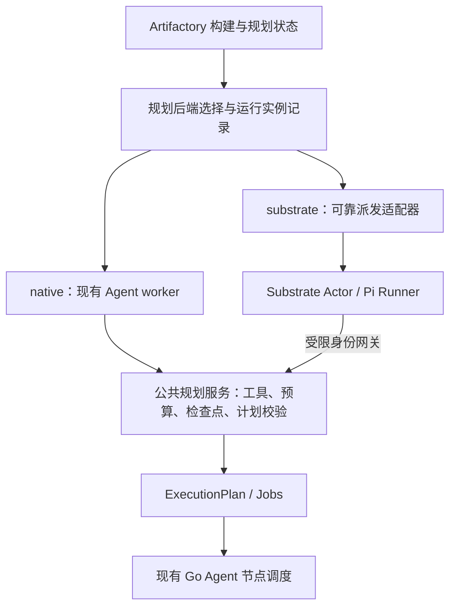

# Substrate / AX 可选调度后端评估

> **后续设计更新（2026-11-12）：** 用户已选择将 native 也调整为 Kubernetes Job/Pod，由独立 Operator 管理，并将源码数据面与运行热路径移出业务控制平面。下文保留首轮评估作为研究依据，其中“native = 现有常驻 Poll Agent worker”和“公共规划逻辑集中在原控制平面”的架构/迁移建议已由 [Operator 架构设计](superpowers/specs/2026-11-12-kubernetes-agent-operator-design.md) 与 [落地计划](plans/2026-11-12-001-feat-kubernetes-agent-operator-plan.md) 取代。Substrate 仍是可选后端，AX 暂缓；本文件固定版本的上游能力和限制仍适用。

> **技术栈确认：** Operator 明确采用 Rust/kube-rs，Runtime/Source 服务也使用 Rust；设备 Artifactory Agent 的现有 Go 实现后续以兼容协议的 Rust 实现逐步替换。下文提及 Go Agent 是当前代码事实，不表示长期语言选型。

评估日期：2026-11-12。范围：Artifactory 的 Pi 规划 Agent 调度，以及它与现有原生构建节点调度的关系。这是方案评估；文中的接口、配置和迁移均为建议，尚未实现或部署。

**建议保留现有 `native` 后端为默认值，增加可选的 `substrate` 规划运行后端。第一阶段直接对接 Substrate，让它负责 Pi 实例的资源分配、沙箱和生命周期；Artifactory 继续负责业务排队、权限、调用预算、检查点、计划校验和构建结果。AX 可作为后续独立适配器，不作为启用 Substrate 的必选依赖。**

这个方向可实施，但需要调整运行协议。当前 Agent worker 不能通过换一个部署镜像就获得 Actor 调度、透明休眠和安全故障切换。现有 macOS / Windows 构建节点及签名执行继续使用 Go Agent；它们对原生操作系统和本机凭据的要求应单独处理。

## 1. 核验依据与版本

| 对象 | 本次核验版本 | 已确认状态 |
| --- | --- | --- |
| Artifactory | 本地 HEAD `b43604021f9e435bb78c507fb6b0fac06d972d21`；同时阅读当前工作区相关文件 | Rust 控制平面、Node.js 24 Pi Worker、Go 原生构建 Agent |
| Agent Substrate | [源码 `905e2a65c4fbe7fd822b73642a7612350815c316`](https://github.com/agent-substrate/substrate/tree/905e2a65c4fbe7fd822b73642a7612350815c316) | 已发布正式版 [v1.0.0](https://github.com/agent-substrate/substrate/releases/tag/v1.0.0)，README 承诺公共 API / CLI / 配置的兼容性 |
| Google AX | [源码 `a72b8ca46cb54a6f9bd53c8bb349d3a2089e7735`](https://github.com/google/ax/tree/a72b8ca46cb54a6f9bd53c8bb349d3a2089e7735) | README 明示仍在密集开发，稳定版前可能大幅变更；资源 API 为 `ax.io/v1alpha1` |

通过远端 Git 引用固定了两个上游源码版本，并下载源码阅读。Substrate v1.0.0 的 peeled commit 为 `b34fbee742906494b5eb4f1f36987176bf8770a4`；另外读取并逐字节比较了它的 `api/ateapi/v1/ateapi.proto`，与上述 main 快照相同。AX 的 `go.mod` 当前依赖 `go.ate.dev/substrate v1.0.0`。

上述比较只证明该公共协议文件一致，不证明 main 的所有实现、默认配置或安装行为都与 v1.0.0 相同。实施时仍需固定发布镜像 digest、沙箱运行时和匹配版本的配置，不能使用浮动 `main` / `latest` 组成未经验证的组合。

本次进行了文档、协议和源码核验，没有部署 Substrate / AX，没有运行真实模型或大规模压测，也没有验证当前本机集群状态。上游宣传和目标容量不作为本项目已达到的性能指标。

## 2. 两个项目分别解决什么

### Substrate：运行实例到计算资源的调度

Substrate 的核心模型是：ActorTemplate 定义工作负载，Actor 表示实例，WorkerPool 提供预热的 Worker Pod，Actor 按资源和选择条件分配到 Worker。一个 Worker 可以承载多个 Actor，并受可用资源和 Actor 数量限制。

它提供的能力包括：

- gVisor / microVM 沙箱、Actor 身份、受策略约束的入口和出口。
- `CreateActor`、`ResumeActor`、`SuspendActor`、`GetActor`、`DeleteActor` 等 gRPC 生命周期 API。
- 按需唤醒和入口路由；资源暂时不足时可以有限等待，之后返回容量错误。
- 文件或内存快照、恢复及 Worker 复用；默认 MEMORY 快照与模板和运行时版本存在兼容关系。
- WorkerPool 由 Kubernetes 管理，支持配置副本数和 HPA；扩容策略仍需要根据业务排队与容量指标配置。

它没有现成的 Artifactory 构建语义：不判断生成的构建计划是否有效、不管理本项目的签名授权，也不决定制品是否能够发布。

Substrate 已有 API 身份认证和 OpenFGA 授权。但其安全文档仍把完整的配额、Actor 间授权等能力列为未来或进行中的工作，不能把运行时权限直接当作本项目的项目权限和模型预算。

### AX：Substrate 上的声明式任务编排

AX 提供 Task、Workspace、Model、Gateway 资源、任务生命周期 API、CLI 和 Runner 约定。它能减少声明运行环境的工作，也引入一套独立的资源、状态和控制平面。

当前核验到的几个具体约束：

- `ax-server` **没有身份认证和授权**；官方要求只暴露给受信客户端，Atespace 也不是租户隔离边界。
- 可以使用自定义 Pi Runner，但镜像必须提供 `/usr/local/bin/ax-task-runner`，实现 readiness、进程监督和恢复约定。
- AX 创建模板时显式使用 `SNAPSHOT_FIDELITY_VOLUMES`。恢复主要保留 `/workspace` 文件，重启进程，不能据此声称 Pi 的内存对话或正在进行的模型请求被恢复。
- Runner 在子命令结束后继续存活；官方说明控制平面目前不读取该命令的退出状态。因此 Task Running / Ready 不能转换为规划成功或构建成功。
- 自动识别空闲并休眠仍列在 AX Roadmap 中。不能将该目标当成已经可直接启用的功能。
- `Task.spec.config` 限制为 16 KiB，完整启动配置约 31 KiB，且明文可读。现有最大约 500 KiB 的压缩对话检查点应留在 Artifactory，通过引用读取。
- AX 按任务名和启动配置生成专用 ActorTemplate。大批同质 Pi 任务可能产生较多模板，需评估创建、初始化和清理开销，不能假定自动复用一个 Pi golden template。

## 3. 与当前实现的对应关系

当前链路为：

```text
提交构建 → 固定源码快照 → planning_runs
        → Agent worker Poll 领取 → 独立子进程运行 Pi
        → submit_plan 校验 → plan_revisions / jobs
        → 调度 Go Agent → 构建 / 签名 / 校验 / 制品
```

可复用的核心包括：

- [planning.rs](../crates/control-plane/src/planning.rs)：领取、租约校验、工具、预算、计划提交和过期恢复。
- [runtime.ts](../packages/agent-worker/src/runtime.ts)：`runTask(task, rpc, signal)` 已将 Pi 推理循环与 RPC 传输分开，是复用 Pi 实现的合适边界。
- [main.ts](../packages/agent-worker/src/main.ts)：现有进程监督、轮询和心跳，可保留为 native 运行入口。
- [scheduler.rs](../crates/control-plane/src/scheduler.rs)：源码解析和原生节点匹配；其中原生构建分配应继续服务两个规划后端产生的 jobs。

| 现有或新增概念 | 对应 Substrate / AX | 建议映射 |
| --- | --- | --- |
| `planning_runs` | 不直接等于 Actor | 一轮业务规划；持有累计预算、截止时间和检查点 |
| 新增规划运行实例 | Actor | 一轮规划的某次物理执行，以 `run_id + generation` 唯一标识 |
| Pi 镜像及工具策略版本 | ActorTemplate | 同类任务共享固定模板；模板内不放任务目标、模型密钥或 Worker 身份 |
| Linux 运行容量 | WorkerPool | 专用于 Pi 运行资源；与当前持有签名配置的原生 node pool 分开建模 |
| AX Task | 可选运行资源 | 若以后使用 AX，作为运行实例的外部记录，不替代 Build / Job / Attempt |

Artifactory 的 Agent worker 和 Substrate 的 Worker Pod 是不同概念。现有“一 Worker 同时一个规划”限制的是 Artifactory 注册身份和主循环；Substrate Worker 可以容纳多个相互隔离的 Actor。

## 4. 方案比较

| 方案 | 收益 | 主要代价 | 本项目判断 |
| --- | --- | --- | --- |
| 保留 native 并扩容 Agent worker | 最大限度复用现有领取、预算和恢复逻辑；运维简单 | 运行实例的隔离、容量和弹性需要自己配置 | 继续支持，作为默认和基线 |
| native + 直接接入 Substrate | 获得 Actor 调度、沙箱、资源池和生命周期；较少重复业务概念 | 需要 Pi Actor Runner、身份桥接、可靠派发和状态协调 | **优先做小范围验证** |
| native + AX + Substrate | 获得声明式 Task / Workspace / Gateway、CLI 和 Runner 框架 | 额外控制平面、API 变更、缺失鉴权、状态重叠及模板开销 | 需要统一 Workspace / MCP 编排时再考虑 |

直接接入 Substrate 的改造量为中等，具备完整故障恢复和身份桥接的交付量高于简单容器化。AX 能节省一部分生命周期包装工作，但不会消除本项目的预算、身份、完成回调和恢复协议工作。

## 5. 推荐架构



建议的配置形态为站点默认 `planning_runtime = native | substrate`，允许项目覆盖；构建创建时保存最终选择。AX 将来可以增加独立适配器，第一阶段无需引入第三个配置值或实现。

适配器只表达少量运行语义，例如：

```text
ensure_execution(run_id, generation, template_ref, context_ref, limits)
observe(handle)
cancel(handle)
delete(handle)
```

这些是候选接口，不是现有 API。业务领取、工具和报告逻辑抽成公共规划服务：native 的原有 gRPC 服务和 Substrate 的受限调用入口都调用它。适配层不复制一套计划校验器、预算计数器或完成判定。

### 共存规则

1. 默认值为 native；历史构建、历史规划和迁移前排队任务都按 native 解释。
2. native 的 Poll 只领取 native 任务；Substrate 派发器只处理 substrate 任务。
3. 后端选择与运行实例记录持久化，不使用临时环境开关来决定一个已运行任务的归属。
4. 修改站点或项目默认值只影响后续构建。活动构建继续使用创建时保存的选择；显式重分配需有独立的撤销和重新领取步骤。
5. 未启用 Substrate 时，控制平面正常启动和工作不依赖其 API、集群或凭据。启用后配置缺失，应明确拒绝对应后端的新派发，不能偷偷改走另一个后端。
6. Substrate 不可用只影响选择该后端的规划；native 任务和已经排队的原生构建仍能继续。
7. 第一阶段保留默认“等待恢复 / 明确失败”的策略。需要自动回退时，只能在确认未派发，或旧执行的业务写权限已撤销后进行；不能仅因一次网络超时就启动 native 副本。

## 6. 运行协议必须补齐的部分

### 可靠派发与唯一执行归属

建议增加运行实例记录，保存 backend、generation、外部 Actor 名称与 UID、模板版本、派发状态、最后观测时间和错误。原始模型调用预算与绝对截止时间仍属于 `planning_runs`，不属于重试的物理实例。

采用事务 outbox 或同等可靠的持久化派发记录：先提交派发意图，再在事务外调用 Substrate。外部 Actor 名称由 `run_id + generation` 确定，创建超时后通过查询协调状态，而不是无条件再建一个 Actor。外部网络调用不能占着规划 / 构建行锁等待。

区分“排队 / 创建 / 等待资源 / ready / 正在执行”。Pi Runner ready 后再通过公共规划服务领取执行租约，避免镜像拉取和资源排队耗尽现有 90 秒执行租约；另外配置独立、可观察的派发超时。现有首次领取时开始的规划截止时间语义应保持一致。

所有工具、预算预留和结果回调校验：构建未取消、run 仍有效、backend / execution / generation 匹配、租约未过期。Actor 同名删除重建时 UID 会变化，映射必须绑定 UID，不能只验证 Actor 名称或路由 header。

### Pi Runner

保留现有 Pi SDK、提示词和工具集合，新增一个面向 Actor 的入口：

- 固定镜像中启动可接收受信调用的 HTTP / gRPC 服务，提供 readiness。
- 接收运行引用后领取任务内容，调用现有 `runTask`；不在镜像中固化某个构建目标。
- 将工具、状态、检查点和完成事件交给公共规划服务。
- 相同 execution 的重复启动请求返回现有运行状态；不重复启动 Pi 子进程。
- 业务状态已提交后，执行异步清理并定期协调遗留 Actor；清理失败不把已成功的计划改成失败。

第一阶段适合“一次规划运行实例一个 Actor”，完成或进入 `needs_input` 后释放。后续澄清 / 修订按照现有业务规则创建新一轮规划，并携带原有上下文。

### 身份和模型密钥

当前控制平面按 Agent worker 的 mTLS 证书识别身份，并将模型密钥经任务响应和 IPC 传给 Pi 子进程。Substrate 采用沙箱外身份和出口凭据注入。二者需要明确的桥接，不能把现有 worker 配置、私钥或模型密钥烘焙进 ActorTemplate / golden snapshot，也不能让大量 Actor 共用同一个 Agent worker 注册身份。

建议在可信边界提供受限网关，验证 Substrate 发行方、audience、Actor UID 与运行实例绑定，再调用公共规划逻辑。Actor JWT 标识 Actor，不自动授予访问任意构建的权限；网关必须验证它只能访问自己的 run。Actor 不需要获得 Substrate 管理权限。

模型端点由平台模型快照固定，通过可信模型代理或受限的出口凭据注入访问。建议复用现有加密模型配置，避免为了 AX Model 再维护另一份独立的密钥和配置真相。真实模型密钥留在沙箱外，并测试 OpenAI / Anthropic 请求及 SSE 流式响应的兼容性。

如果要把调用次数限制作为不可信 Actor 无法绕开的边界，模型代理必须在转发前验证并预留该 run 的预算；只接受 Agent 自报 `Report(model_call)` 不足以提供这种保证。代理与现有 Report 应复用调用预留标识，避免重复扣数。这个能力需要单独实现和验证，上游沙箱本身不会代替业务计费限制。

## 7. 休眠与恢复：第一阶段的范围

现有规划租约为 90 秒、心跳每 10 秒；默认每轮 600 秒 / 20 次调用。Worker 还有本地心跳中断和任务截止定时器。直接冻结进程会同时停止心跳：平台可能将任务重新排队，恢复后的旧 Pi 仍带着失效租约。

因此第一阶段建议：

- 正在规划的 Actor 连续执行，使用现有业务心跳和绝对截止时间。
- 进程或 Worker 故障时，以平台最后持久化的 Pi 对话检查点恢复，累计预算不重置。
- 等待用户输入时按现有 `needs_input` 流程结束本轮，不保留一个持有活动租约的休眠进程。
- Runner / Actor Running 只表明基础设施运行；规划成功必须来自有效的 `submit_plan` 事务，构建成功必须来自构建 Agent 和制品校验。

第二阶段若确有中途休眠需求，应增加显式 checkpoint / yield / 重新领取协议：休眠前保存业务状态并撤销旧执行权限；恢复时刷新 generation 与租约，重连外部请求，按照原有绝对截止时间和剩余预算继续。不能为了让快照恢复通过而放宽过期检查。

Substrate 支持 MEMORY 快照，但恢复可能受模板 / 运行时影响而退回冷启动；AX 当前使用 VOLUMES 快照。两种后端都需要应用层检查点。上游默认异步 suspend 只先保证节点本地检查点，节点故障前未完成上传可能丢失；需要持久快照时应选择同步模式并确认远端完成。基础设施快照不会撤销已发出的模型调用或替代业务幂等性。

## 8. 大规模收益与仍存在的瓶颈

Substrate 对大量长期存在、经常等待外部事件的 Actor 很有价值。当前 Artifactory 的 Pi 规划则是有界运行：排队任务只占数据库记录，等待用户输入时子进程退出，本来就没有为每个逻辑 Agent 常驻一个容器。

因此，第一阶段可预期的收益是统一的资源池、运行隔离、按需启动和运维能力。不能直接把上游“百万 Agent / 10 倍密度 / 亚秒恢复”等叙述换成本项目容量承诺。应分别测量注册 Actor 数、同时执行的 Pi 数、启动吞吐和每轮完成延迟。

仍需注意：

- **模型配额。** 当前服务端已按模型配置协调 RPM。假设每分钟额度 600 次、每轮平均 10 次调用，模型侧上限约为每分钟 60 轮；增加 Actor 不会提高这个上限。这是算例，不是实际账户配额。
- **内存。** 假设每个活动 Actor 预留 512 MiB，1000 个同时活动实例就需约 500 GiB，再加运行时和预热容量。大量暂停实例与大量同时活动实例是不同的容量目标。
- **源码解析。** 目前源码解析使用全局 advisory lock，且解析循环每次处理一个构建。短规划大量到达时，这可能先于 Pi 资源池成为瓶颈，需要基线测量后再调整。
- **数据库和工具。** 控制平面的连接池、每次工具调用的事务、源码读取和日志访问仍由 Artifactory 承担。Substrate 只改变运行资源分配，不消除这些请求。
- **扩缩容。** WorkerPool 支持 HPA，但配额、最小预热容量、排队驱动指标、节点扩容和排空处理需要配置；AX 没有替本项目完成这些策略。
- **原生环境。** Substrate 的 Linux gVisor / microVM 运行环境不能直接提供 macOS Xcode、Windows 原生工具和本机签名身份。Linux 构建若未来也接入，需要另行验证系统调用、依赖网络、缓存、设备及制品上传。

部署前需核对目标 Kubernetes 的 PodCertificateRequest / ClusterTrustBundle 等 API、CNI 策略、Linux 沙箱宿主条件、镜像架构和快照对象存储。不能从过去某次 kind 演示成功推断当前集群或生产环境可用。

## 9. 故障路径与验收重点

| 场景 | 建议行为与可验证结果 |
| --- | --- |
| 正常规划 | 两个后端使用同一套工具与计划校验；最终生成有效 plan revision 和 jobs |
| 未配置 Substrate | native 正常启动和完成构建；显式选择未配置后端得到清楚的配置错误 |
| 没有可用 Worker / Actor 无容量 | 记录等待资源并有界重试；不显示为运行成功，不因单次容量错误立即切换后端 |
| 创建 Actor 已提交但响应超时 | 使用确定的外部标识查询协调；只有一个有效 execution 取得写权限 |
| 取消与提交计划并发 | 复用现有事务排序；取消生效后旧实例不能再创建 jobs |
| 旧 Actor 复活 / 同名重建 | UID、generation 和租约校验拒绝旧回调 |
| Worker / 控制平面重启 | 从持久化记录协调，预算、检查点和后端归属不丢失 |
| 模型失败 / 预算耗尽 | 使用现有错误分类和终态；重建 Actor 不重置同一轮预算 |
| 清理失败 | 有限重试并观测遗留 Actor；成功业务结果保持成功 |
| 切回 native 默认值 | 后续构建使用 native；已经启动的 substrate 执行保持原归属或先撤销再重分配 |

性能验证建议先测 native 基线，再在相同模型 / 配额、源码快照、工具和机器资源下比较后端。可按 100 / 500 / 1000 活动实例和 1 万排队任务逐级测试；这些是候选试验规模，需根据实际资源缩放，不是当前可达的承诺。

高并发运行时测试可先使用受控模型 fixture，测派发、资源和恢复；随后用真实模型验证完整构建链路与供应商限流。fixture 的吞吐不能代替真实模型吞吐，Linux 沙箱测试也不能代替 macOS / Windows / 签名验收。

至少记录：排队时延、Actor 冷 / 热启动 P50 / P95 / P99、每轮完成时延、有效运行数、重复与过期结果拒绝数、取消收敛时间、CPU / RSS、快照字节与 I/O、数据库等待和模型限流。是否继续扩大接入应依据这组结果与运维成本决定。

## 10. 建议推进顺序

1. **基线和边界。** 明确目标是活动并发、排队总量还是长期会话数，采集 native 实际数据；确认 Pi 规划是第一阶段工作负载。
2. **先保住 native。** 抽取公共规划逻辑与后端选择，旧数据默认 native，运行实例与派发意图持久化；尚未配置 Substrate 时行为与现状一致。
3. **接入 Substrate 小范围验证。** 固定 v1.0.0 兼容协议和镜像，提供 Pi Actor Runner、身份桥接、模型访问和完成回调；先连续执行每轮规划，验证故障恢复与清理。
4. **按结果扩容。** 增加排队驱动扩容、项目并发配额、批量协调和可观测性；通过对照压测再扩展项目覆盖。中途休眠另行实现并验收。
5. **按需求决定 AX。** 若确实需要统一的 Task / Workspace / MCP 声明和 CLI，再增加 AX 适配器。先满足其受信访问边界、Runner 合同、完成判定和协议兼容要求。

初期改动预计集中在 `crates/control-plane/src/planning.rs`、后端配置与数据库迁移、新增运行适配模块、`agent-worker` 的 Actor 入口以及可选部署配置。Go 原生构建协议不需要因第一阶段接入而整体重写。

## 11. 主要上游来源

- [Substrate README：定位、沙箱、1.0 兼容性](https://github.com/agent-substrate/substrate/blob/905e2a65c4fbe7fd822b73642a7612350815c316/README.md)
- [Substrate 架构：Actor / Worker、生命周期、快照与持久性](https://github.com/agent-substrate/substrate/blob/905e2a65c4fbe7fd822b73642a7612350815c316/docs/concepts/architecture.md)
- [Substrate API 指南：资源、放置和 suspend](https://github.com/agent-substrate/substrate/blob/905e2a65c4fbe7fd822b73642a7612350815c316/docs/reference/api-guide.md)
- [Substrate 安全边界及仍在进行的能力](https://github.com/agent-substrate/substrate/blob/905e2a65c4fbe7fd822b73642a7612350815c316/docs/security/security.md)
- [Substrate Actor JWT：验证、Actor UID 与身份复用](https://github.com/agent-substrate/substrate/blob/905e2a65c4fbe7fd822b73642a7612350815c316/docs/guides/actor-jwts.md)
- [Substrate 出口凭据注入](https://github.com/agent-substrate/substrate/blob/905e2a65c4fbe7fd822b73642a7612350815c316/docs/guides/egress-credential-injection.md)
- [Substrate v1.0.0 公共 gRPC 协议](https://github.com/agent-substrate/substrate/blob/b34fbee742906494b5eb4f1f36987176bf8770a4/api/ateapi/v1/ateapi.proto)
- [AX README：开发状态和操作方式](https://github.com/google/ax/blob/a72b8ca46cb54a6f9bd53c8bb349d3a2089e7735/README.md)
- [AX SECURITY：当前服务端没有鉴权](https://github.com/google/ax/blob/a72b8ca46cb54a6f9bd53c8bb349d3a2089e7735/SECURITY.md#current-trust-boundary)
- [AX Runner 合同：恢复、入口路径、状态和大小限制](https://github.com/google/ax/blob/a72b8ca46cb54a6f9bd53c8bb349d3a2089e7735/docs/runner.md)
- [AX 模板实现：VOLUMES 快照](https://github.com/google/ax/blob/a72b8ca46cb54a6f9bd53c8bb349d3a2089e7735/internal/substrate/client.go#L365)
- [AX Reconciler：每任务模板与启动配置](https://github.com/google/ax/blob/a72b8ca46cb54a6f9bd53c8bb349d3a2089e7735/internal/controller/reconciler.go#L173)
- [AX Roadmap：自动空闲休眠等规划能力](https://github.com/google/ax/blob/a72b8ca46cb54a6f9bd53c8bb349d3a2089e7735/docs/roadmap.md)
