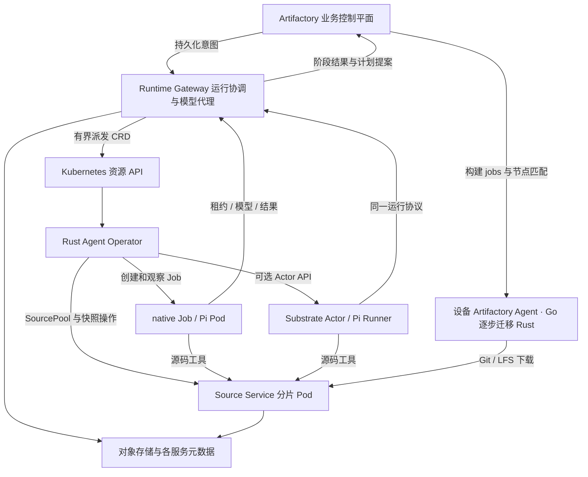

# Kubernetes Agent Operator 架构设计

> 历史设计与计划归档。本文保留当时的决策和实施背景，不作为当前功能清单；实际结果以对应版本的源码与验收记录为准。

**建议将 native 调整为 Kubernetes Job/Pod 后端，以 Rust 编写的独立 Operator 项目管理 Pi 与源码处理资源；Substrate 作为可选 Actor 后端。两种后端共用 Rust 运行协调服务和源码服务，业务控制平面保留业务决策与最终计划接纳。设备端 Artifactory Agent 后续迁移到 Rust。**

本文记录已确认的架构；native 首期实现、独立集群部署与实际验收见[实施计划](../../plans/2026-11-12-001-feat-kubernetes-agent-operator-plan.md)和[验收记录](../../acceptance/operator/2026-11-12.md)。Substrate 后端与 Rust 设备 Agent 属于后续阶段。本文更新了[先前 Substrate / AX 评估](../../substrate-scheduling-assessment-2026-11-12.md)中的 native 定义和职责划分；上游能力与限制仍以该评估固定的源码版本为依据，容量结论以实测记录为准。

已确认的业务链路是：控制平面委托 Kubernetes 中的 Pi 评估仓库、生成构建计划；控制平面校验后创建并分配正式任务；各设备上注册认证后的 Artifactory Agent 执行构建并回传结果。下文的 Go Agent 描述当前实现；设备 Agent 是独立于实现语言的角色，未来由 Rust 实现接替。

## 1. 目标与边界

### 执行与兼容

- **R1：** native 的目标形态为 Kubernetes Job/Pod，Substrate 为可选后端；未安装 Substrate 时能够完成同样的规划业务。
- **R2：** Operator 使用 Rust，是加入根 Cargo workspace 的独立 package、镜像与部署单元，初期放在本仓库 `operator/`；复用现有 Pi 推理循环和 Rust 源码逻辑。
- **R3：** 保留现有业务排队语义、计划修订规则与设备节点匹配。Operator 首期兼容现有 Go Agent；后续以兼容协议的 Rust Artifactory Agent 逐设备迁移，继续在设备上执行 macOS、Windows、Linux 构建与本机签名。

### 卸载与正确性

- **R4：** Git 拉取、源码读取/搜索、索引、Git/LFS 字节传输和缓存维护移出业务控制进程。
- **R5：** Pi 心跳、运行租约、检查点、模型调用计数和全局模型限流移到独立运行协调服务。
- **R6：** 重试不改变源码，不重置同一逻辑运行的预算/截止时间；重复进程和迟到回调不能重复创建业务 jobs。
- **R7：** 取消、项目权限、源码访问范围和最终计划校验保留明确的权威状态，不能由 Pod/Actor 的运行状态替代。

### 扩容与交付

- **R8：** 排队任务放在持久化队列中；CRD 只表达有限数量的在途操作，不承载逐次工具调用或大块数据。
- **R9：** 分阶段迁移、支持停止接入和回退，并通过控制平面负载、故障恢复与端到端结果验收。

首期“代码分析”指固定快照的文件树、路径/搜索索引、Git 元数据及构建清单识别；模型推理由 Pi 完成。语义向量库、任意代码执行、通用工作流引擎、AX 集成和执行中透明休眠不纳入首期。

## 2. 当前负载在哪里

设计基线 HEAD 为 `6f993612d64b14a15dfa74dd874f883686b1988d`。下表记录改造前 Poll 路径的行为；改造后的 Kubernetes 路径及对照数据见验收记录。

| 当前路径 | 已核对行为 | 设计影响 |
| --- | --- | --- |
| [planning.rs](https://github.com/zhubby/artifactory/blob/main/crates/control-plane/src/planning.rs) | FIFO + `SKIP LOCKED` 领取，每个 Agent worker 同时一个规划；90 秒租约；首次领取启动默认 600 秒逻辑截止时间，重试保留它 | 可复用业务规则，但每个 Pi 的租约与调用不能继续落在业务控制平面 |
| [main.ts](https://github.com/zhubby/artifactory/blob/main/packages/agent-worker/src/main.ts) / [runtime.ts](https://github.com/zhubby/artifactory/blob/main/packages/agent-worker/src/runtime.ts) | 空闲约每 2 秒 Poll，运行约每 10 秒心跳；父进程监督 Pi 子进程；`runTask` 分离了推理与传输 | 复用 `runTask`，增加按运行启动的入口，逐步退出常驻 Poll 模式 |
| [source_cache.rs](https://github.com/zhubby/artifactory/blob/main/crates/control-plane/src/source_cache.rs) | 在控制进程内执行 Git、递归 submodule、LFS、快照恢复、搜索、证据路径核验和缓存回收 | 需要抽取源码服务，单独搬 Pi 不会卸掉这些负载 |
| [source_http.rs](https://github.com/zhubby/artifactory/blob/main/crates/control-plane/src/api/source_http.rs) | Git/LFS 数据经过控制进程；传输持有防回收锁/事务，限制为 6 个并发传输 | 数据面应直接路由到源码服务，传输保护不再占用业务数据库长事务 |
| [scheduler.rs](https://github.com/zhubby/artifactory/blob/main/crates/control-plane/src/scheduler.rs) | 源码解析用全局 advisory lock；另有 Go 节点 OS/arch、工具、签名、pool/slots 匹配 | 源码操作改为仓库级并行；保留 Go 节点业务调度 |
| [main.rs](https://github.com/zhubby/artifactory/blob/main/crates/control-plane/src/main.rs) | 业务 PostgreSQL 连接池上限 20 | 运行和源码使用独立连接池、数据所有权，避免长操作挤占业务事务 |

例如 1,000 个活动 Pi、10 秒一次心跳，对应约 100 次心跳/秒；1,000 个空闲 Poll Worker 对应约 500 次领取请求/秒。这只是由当前周期推导的请求量，不能作为实际容量测试结果。

## 3. 组件与调度分层

图中的 Runtime Gateway 是独立服务，**不是**原控制进程的一个新路由名。它包含运行协调和模型代理，首期合并部署以减少组件数量。

Source 为内部 RPC 与设备下载维护独立地址。Pi、元数据和证据核验使用 shard 的 Kubernetes HTTPS 地址；集群外设备使用 SourcePool `publicUrlTemplate` 指定的公开下载网关。control-plane 固定保存两个 origin，Git/LFS 字节由 Source 直接发送给设备，公开网关只暴露下载路径。

| 组件 | 负责 | 不承担的职责边界 |
| --- | --- | --- |
| 业务控制平面 | 用户/项目权限、Build 目标、授权上下文、预算配置、计划接纳、修订、设备构建节点调度、制品与发布 | 不执行 Git/索引，不承载源码字节流，不接收每个 Pi 的周期心跳 |
| Runtime Gateway | 持久化运行队列、准入、attempt/fencing、执行租约、检查点、预算、全局模型限流、结果重投递、Kubernetes 意图派发 | 不决定计划是否合法、签名能否执行或制品能否发布 |
| Rust Operator | 依声明式资源调谐 Job、Actor、源码服务 Pod/PVC 和源码操作；观测基础设施状态、清理临时资源 | Reconcile 中不跑 Git、索引、LLM 或持续数据流，不自行发明业务重试 |
| Kubernetes / Substrate | Kubernetes 给 native Pod 选择 Node；Substrate 给 Actor 选择 Worker | Operator 选择承载方式；这些资源调度不替代业务排队或构建节点匹配 |
| Source Service | 固定/恢复源码、Git/LFS、文件工具、确定性分析、缓存/存储、证据核验、读取保护 | 不接纳业务计划，不持有业务 master key 或签名密钥 |
| Pi Runner | 调用现有 `runTask`，使用授权工具与模型代理，产生提案/问题/检查点 | 不持有业务数据库凭据、模型供应商主密钥或集群管理权限 |

用户仍通过 Artifactory 创建、取消和查看 Build。后端选择是项目/运行池策略，提交时固定在 run intent 中；无需用户操作 CRD 才能完成构建。

### Rust 技术栈与项目边界

| 组件 | 目标技术栈 | 说明 |
| --- | --- | --- |
| 业务控制平面 | Rust / Tokio / Axum / Tonic | 沿用现有实现 |
| Agent Operator | Rust / kube-rs / kube-runtime / k8s-openapi | 独立 package、二进制与镜像；CRD 由 Rust 类型和 schema 生成 |
| Runtime Gateway / Source Service | Rust / Tokio / Tonic，HTTP 按需使用 Axum | 独立进程与数据所有权，复用现有 Rust 逻辑 |
| 设备 Artifactory Agent | 当前 Go，后续 Rust / Tokio / Tonic | 通过版本化 protobuf 与控制平面互通，逐平台替换 |
| Pi Agent / Runner | 上游 Node.js / TypeScript 运行时 | Kubernetes Pod 承载，复用现有推理循环；本次不重写 Pi 本身 |

Operator 采用 kube-runtime 的 Controller、watcher、finalizer 和有界并发调谐；使用 `coordination.k8s.io/Lease` 做主实例选举，所选 Lease 实现需单独验收，不假设 kube-runtime 已提供完整选举方案。失去主身份后停止派发和资源变更；短暂双主、请求超时仍由幂等资源身份、资源版本和 Runtime fencing 兜底。Kubernetes Job 的执行节点仍由 Kubernetes scheduler 选择。

Operator 到 Runtime 及可选 Substrate 的 gRPC 客户端使用 Tonic/Prost 从固定 protobuf 生成；接入 Substrate 不要求引入 Go SDK 或 Go 包装进程。共享范围限于协议、无状态类型和明确的公共库，不能因统一语言而合并服务进程或直接访问其他服务的数据库。`kube`、`k8s-openapi`、Rust MSRV、Tonic/Prost 和 Kubernetes 最低版本在实施时固定兼容矩阵。

## 4. 最小资源模型

新增 API 首期采用 `v1alpha1`；具体 API group 在协议单元定版。下面均为拟新增资源，不是现有能力。

| 资源 | 生命周期与主要意图 | Operator 输出 |
| --- | --- | --- |
| `AgentPool` | 长期；`backend=native/substrate`、允许的镜像 digest、资源档位、调度约束、在途并发上限、后端连接引用 | 可用性/容量条件、策略版本；native 不要求预先启动常驻 Poll Worker |
| `SourcePool` | 长期；分片配置、缓存存储模板、资源上限、分析并发与保留策略 | StatefulSet、Service、PVC 及健康/分片条件 |
| `SourceSnapshot` | 有界在途源码操作；repository 身份引用、授权域/凭据版本引用、requested ref 或已固定 manifest、分析版本、operation ID | 物化/分析阶段、固定的 manifest digest、分析结果引用、错误分类 |
| `AgentRun` | 有界在途逻辑运行；run/build ID、AgentPool、snapshot digest、上下文/预算引用、明确的 attempt generation、取消意图 | observed generation、Pod/Actor UID、启动/停止等基础设施条件 |

仓库凭据、缓存目录和仓库到分片的映射存放在 Source Service 元数据库；不额外引入一个与项目仓库配置重复的 `SourceRepository` CRD。AgentPool 与 Go 构建节点 pool 是不同资源。

资源写入约定：Runtime Gateway 的持久化 dispatcher 是 `AgentRun` / `SourceSnapshot` 意图写入者，Operator 是其 `status` 写入者。平台管理员管理两个 Pool；Operator 通过独立 Runtime Control API 注册/汇报外部资源。CRD 不是结果或预算的权威数据库。

AgentRun 的上下文、snapshot、预算和 pool 版本固定后不可变；只有授权的取消及新 attempt 指令可变。`metadata.generation` 用于 Kubernetes 调谐观察，**不能**代替运行协议的 `attempt_generation`。外部资源按 run ID + attempt generation 确定性命名，并核对 UID。

完整 checkpoint、日志、源码 manifest、计划正文和 secret 不进入 CRD。CRD 只保留短引用、digest、有限条件/错误摘要；以小对象为设计目标，并在准入时设定序列化大小上限。终态资源完成结果交接与清理后按保留窗口移除，持久化历史保留在数据库/对象存储。

## 5. 状态和数据的唯一权威

| 存储 | 唯一权威内容 | 跨服务传递方式 |
| --- | --- | --- |
| 业务 PostgreSQL | Build、权限/授权上下文、源码引用、逻辑 run 意图、已接纳提案、plan revision/jobs、Go attempt 状态、业务 outbox | 带 aggregate version 的意图和幂等结果接纳 |
| Runtime PostgreSQL | 执行状态、attempt generation、租约、累计调用/usage、全局 profile 限流预留、checkpoint 引用、运行 outbox | Runtime API、短期 grant、阶段事件 |
| Source PostgreSQL | 仓库/授权域、固定快照/分析元数据、分片路由、操作状态、读取保护和保留引用 | Source API、manifest digest、验证结果引用 |
| S3 兼容对象存储 | 不可变源码包/对象、LFS、分析结果、checkpoint、计划提案等大对象 | 按授权域隔离的对象键、内容 hash 和短期访问权限 |
| 分片 PVC | 可重建的 bare Git/LFS 热缓存与本地索引 | 只由所属分片访问 |
| Kubernetes etcd | 期望基础设施、外部资源引用、粗粒度观测条件 | CRD watch/reconcile |

Runtime/Source 可先共用 PostgreSQL 服务，但必须分库或分 schema、独立角色/连接池，禁止直接写业务表。共用实例只能隔离连接和代码责任，不能声称已经隔离数据库 CPU/I/O；扩容验收需包含独立实例配置。S3 前缀、生命周期和 IAM 按业务数据、运行数据、源码数据区分。

业务 `planning_runs` 保留 run 身份、业务关联和可查询摘要；新后端的执行计数与租约只由 Runtime 更新。迁移期间必须给每个 run 标记唯一执行 authority，避免两套服务同时领取、计数或续租。

## 6. 源码、分析与存储设计

### 6.1 固定一次，始终按 manifest 工作

1. Build 事务产生源码意图和保留请求。Runtime dispatcher 创建/协调 SourceSnapshot，Source Service 异步取回源码。
2. 继承现有 root commit、tag identity、递归 submodule 与 LFS 处理；保留现有深度/数量限制。分支名只在初次解析时使用。
3. 写入经过 hash 核验的完整 manifest、Git 可恢复对象/包及 LFS 对象；上传完成并确认可恢复后才发布固定 digest。
4. 生成基础文件树、路径/搜索索引、构建清单信息；分析结果绑定 snapshot digest + analyzer version + profile。空仓库、缺失 ref、无法访问的 submodule/LFS 必须返回明确错误或完整性状态，不产生伪 Ready。
5. Build 记录固定引用后才准入 Pi。重试/切换承载不得重新解析移动分支；缓存丢失时从不可变对象恢复相同 manifest。

为旧构建补齐对象存储时保持原 snapshot ID、commit、tag/submodule/LFS 身份；仍无法取回的历史对象标记不可恢复，不替换成当前分支。新的 snapshot 在进入 Ready 之前必须具备持久化保留记录。

### 6.2 分片与分析 Pod

SourcePool 管理分片 StatefulSet，每个分片持有自己的 PVC；缓存键沿用项目/仓库/凭据版本的隔离语义。每个仓库授权域内串行更新 Git，独立仓库可并行。下载读保护和回收协调由 Source Service 自己管理，不持有业务数据库事务。

首期分析在所属源码分片 Pod 的有界工作队列执行，复用 Rust 实现。若测得分析 CPU 成为热点，再由 Operator 拆成独立分析 Job：从对象存储读固定快照，使用 `emptyDir`，按 digest 幂等发布分析结果。分析 Job 不挂载另一个节点上的分片 RWO PVC。源码下载/工具请求与后台分析分别限流，避免一次大仓库扫描阻塞运行中的 Pi。

RWO 允许同一节点上的多个 Pod 挂载，不能作为 Git 并发写保护。可用时选 RWOP 提供单 Pod 挂载边界，仍保留仓库写锁。分片路由显式持久化；增加副本不直接对已有仓库重新取模，采用排空写入、复制/恢复、切换路由的迁移过程。

### 6.3 谁直接访问源码

- Pi 的 `list_tree/read_file/search_source/git_metadata` 直接调用 Source Service；保持现有分页、256 KiB 文件读取与有界搜索语义。初期复用 Git 检索保证正确性，索引优化必须返回同一固定快照的结果。
- Go Agent 从 Source Service 读取 Git upload-pack / LFS，Ingress/独立 source origin 直接把数据流送到该服务。现有 descriptor 可继续使用绝对 URL，不依赖跨 origin 重定向转发凭据。
- Pi 使用 Runtime 的 run/generation/UID grant。Go Agent 的 attempt 权威仍在业务控制平面，源码服务在新传输授权及等待缓存锁后通过短请求重新核对；只传递权限元数据，不传源码字节、不保持业务长事务。业务服务不可用时新的 Go 下载授权失败关闭。
- 计划证据路径由 Source Service 对固定快照核验。业务服务在事务外取得绑定 snapshot/proposal digest 和验证版本的结果，再进入短事务重查取消/版本/权限并接纳计划；不再本地调用 Git。

当前 Go attempt 的取消/租约和签名限制继续有效。源码锁等待后必须再次核验授权，不能因为下载 URL 尚未过期就允许失效 attempt 开始读取。正在进行的数据流按服务读取租约处理，取消不承诺收回已经传出的字节。

### 6.4 保留与回收

源码不是 AgentRun 的一次性临时文件。Build/Release 的持久化引用、在途源码保留请求、活动读取都保护对象；CRD 的 OwnerReference/finalizer 不级联删除它们。删除 SourcePool 默认保留 PVC 和对象。

采用带幂等键的保留/释放协议及分阶段 GC。新快照先建立保留再返回 Ready；回收前核对业务保留清单与未交接操作，业务引用权威不可用或引用同步未收敛时暂停删除。只有取消了所有保留且经过隔离窗口的对象才可物理删除，失败可重试。PVC 缓存可独立逐出，不能据此删除唯一持久化副本。

## 7. 运行协议：native 与 Substrate 共用

### 7.1 派发、启动与执行

1. Build 的 run intent 与业务 outbox 同事务提交，包含已授权上下文、snapshot digest、模型 profile/预算配置版本、选定 pool/backend。
2. Runtime 按 intent ID 幂等接收；同 ID、不同内容 hash 拒绝。按 Build/run 的 aggregate version 拒绝乱序旧事件；取消先到时建立 tombstone，迟到的创建不能复活运行。队列按现有 FIFO 语义起步，按项目/pool 设置有界准入，只有获准的在途 run 生成 CRD。
3. Runtime 授权 attempt generation，Operator 创建外部资源并注册实际 UID。创建超时先按确定性标识查询，不盲目再创建。
4. Runner 以已注册的 Pod/Actor 身份兑换短期 grant。同一 run/generation 通过原子领取只允许一个有效 UID；未成功领取不调用模型。
5. 成功领取启动逻辑执行截止时间，默认沿用 600 秒/20 次调用；租约默认沿用 90 秒、约 10 秒续租。排队/拉镜像使用独立等待与 provisioning 超时，不消耗执行租约；分别限制 provisioning 和执行重试次数，不能因尚未启动逻辑时钟而无限建 Pod。首次执行后，重建期间仍消耗既有逻辑时间，不重置 deadline。
6. 工具数据走 Source Service，模型走 Runtime 模型代理，checkpoint 先写对象存储后幂等发布引用。权限相关 `node_capabilities` 和构建日志仍可通过有界的业务元数据查询获取；首期保留这些少量请求，单独观测。
7. 提案/问题先持久化，再投递业务接纳请求。正常路径等待校验反馈：可修正的 schema/证据/目标校验错误作为工具错误返回 Pi，在同一预算内继续修正；权限撤销、取消等错误终止运行。不能把每次提案拒绝都改成逻辑 run 失败。
8. 业务服务幂等接纳，返回已创建 revision/jobs 或拒绝原因。Runtime 收到接纳确认才记录业务成功，Runner 随后退出。业务服务暂不可用/确认未知时保存 pending submission 与恢复边界，按原 request ID 查询/重投递；Runner 可有界等待，完整交接后才退出，不因 ack 丢失重跑模型。

逻辑状态为 Queued → Provisioning → Running → AwaitingAcceptance → Accepted；可修正的校验错误从 AwaitingAcceptance 回到 Running，另有 Rejected、NeedsInput、Canceled、TimedOut、Failed 终态。等待时禁止新的模型调用。若 Runner 已退出后才收到可修正错误，Runtime 仅在剩余 deadline/预算允许时恢复同一 run 并注入该反馈；必须先恢复 pending submission 的确定结果，不能重新提交或推理一个结果未知的操作。基础设施状态单独呈现：Pod/Actor Ready 或 Job Complete 不等于 Accepted，更不等于 Build 成功。

`needs_input` 结束当前 run 并释放 Pod/Actor；用户回答后按现有 clarify 行为创建新 run、继承问题回答与模型配置，获得新一轮预算。它与同一 run 的故障重试不同，后者必须累计原预算。

### 7.2 Fencing、预算和结果接纳

每个运行请求绑定 run ID、attempt generation、外部 UID、租约和 request/event ID。Runtime 以原子状态转移撤销旧 generation 后才允许新 attempt 领取；旧进程即使仍物理存活，也不能再取得模型调用、发布 checkpoint 或提交有效结果。Source Service 在读取准入和锁等待后核对有效授权。

模型代理是新协议下调用计数与全局 profile 限流的唯一预留者，覆盖 native 和 Substrate。先持久化 request ID 预留再调用供应商；重复请求重放已知结果/状态，不重复预留或并发转发。供应商超时且结果未知时保留该次消耗，不能盲目退还预算并重发同一请求。usage 结算幂等；Pi 的 Report 不再作为第二个计数入口。代理故障时不能绕过它直连模型。

代理保留当前 `openai-completions`、`openai-responses`、`anthropic-messages` 三种 API、流式响应/工具调用与 Qwen 兼容设置。Runner 使用代理地址与 run grant，供应商地址/认证由代理从固定 profile 解析；不能让 Runner 自传上游 URL 或认证头。取消流、部分响应和断流都须结算同一次预留，不能被 HTTP 客户端隐藏重试重复发送。此兼容性是迁移门槛，不将现有模型配置静默缩减为一种协议。

接纳事务以 run/proposal 身份保证幂等，重查 Build 取消、逻辑 deadline、当前修订、授权范围、源快照、有效提案登记及平台/签名约束；revision/jobs 只创建一次。一个提案一旦被 Runtime 持久登记为 AwaitingAcceptance，就冻结该提案，不发起新的推理 attempt。确认丢失时查询/重投递已登记提案；只有已确认的可修正拒绝才能开启后续修正，使用新的 proposal ID，仍属于原 run。

逻辑 deadline 也约束新计划接纳：在 deadline 前已提交成功但 ack 丢失的事务，之后仍可查询原结果；若尚未接纳且已到期，不能因提案曾经保存过而继续创建 jobs。超时与未知确认同时发生时先查接纳记录，防止把已生效的计划误判为未生效并重跑。

### 7.3 取消与故障

| 事件 | 必须实现的行为 |
| --- | --- |
| 用户取消 | 业务事务立即拒绝后续计划接纳并写取消 outbox；Runtime 收到后撤销 grant，Operator 删除/终止资源。区分“业务已取消”与“物理停止已观察到” |
| 控制平面与 Runtime 断联 | 已授权运行可在既定预算/deadline 内执行并保存提案；业务取消向执行侧收敛可能延迟，最终接纳仍由业务事务拒绝。恢复后按版本重放，不假装已经停止 |
| Runner 与 Runtime 断联 | 无法续租/代理调用后停止；旧 grant 到期失效。租约过期后可在原预算/deadline 内创建新 generation |
| Job/Actor 创建结果未知 | 使用固定 ID 查询并对照 UID；确认状态前不转投另一后端 |
| Job 退出但没有结果交接 | 记录协议失败，不转换成规划成功；由 Runtime 决定有界重试 |
| Operator 重启 | 从 CRD、Runtime 与外部资源协调恢复；运行回调不依赖 Operator 存活 |
| Source Pod/PVC 丢失 | 从持久对象重建同一快照；若对象缺失则明确失败，不读取移动 ref 顶替 |
| 清理失败或节点失联 | 保留清理状态并重试；不回滚已接纳计划，不把不可观察节点标成已物理停止 |

native Pi Job 首期设置单 completion/parallelism、`restartPolicy=Never`、`backoffLimit=0`；由 Runtime 统一决定新的物理 attempt。Kubernetes 仍可能重复启动，因此这些配置不能代替 fencing。Job 的基础设施 deadline 覆盖 provisioning 上限与剩余执行时间；真正的逻辑 deadline 始终由 Runtime 强制，不能每次创建 Job 重新计时。

## 8. 身份与访问边界

- 业务服务与 Runtime/Source 的管理 API 使用服务身份及项目范围校验。Operator 只获得工作命名空间所需的 CRD、Job、Pod、StatefulSet、Service、PVC 权限；不拥有业务数据库或签名凭据。
- native Runner 使用明确 audience 的短期投射 ServiceAccount 身份；Runtime 验证 token、已登记 Pod UID/namespace/run 标签与 intent hash，兑换绑定 generation 的 grant。Runner ServiceAccount 没有 Kubernetes 管理权限；TokenReview 等验证权限仅给验证服务。
- Actor 使用固定版本的 Substrate 身份验证能力，并核对 Actor UID 与已登记 attempt；不通过镜像内置长期 Worker 证书。原生与 Actor 的 grant 最终由同一 Runtime authority 颁发。
- 模型密钥只由模型代理按 profile 获取；仓库凭据由业务侧或专门的凭据 broker 按 repository/auth version 对源码服务短期交付。源码服务不复制整把业务 master key。轮换后新 fetch 使用新授权域，旧快照的读取仍需当前业务权限。
- Runner 的 Source/模型/回调出口受网络策略约束；Pool 只允许受控镜像和工具档位。仓库内容作为数据处理，不执行其脚本，不允许源码路径越界或任意对象 URL 访问。
- 大对象按 scope 隔离，日志/错误摘要不输出凭据；secret、token 和模型主密钥不得写入 CRD、启动参数或提案。备份和对象保留按敏感源码/对话数据处理。

重点防止三个问题：重复 Pod 绕过预算、不同项目通过共享缓存越权读源码、Runner 凭据升级成集群/业务管理权限。分别由唯一预留 authority、授权域与逐次 grant、最小服务身份来限制。

## 9. Substrate 与 AX 的位置

native 使用 Job/Pod；Substrate 使用直接 Actor 适配器，Operator 将相同 AgentRun 解释为对应资源。公共协议包括启动上下文引用、运行身份、工具、模型代理、检查点、取消及结果交接，后端只处理实例生命周期。

首期 Substrate 连续运行一次规划，不启用运行中 suspend/resume。内存/卷快照不能自动替代逻辑检查点和运行租约，休眠前还需停止接单、保存并确认 checkpoint、撤销旧租约、恢复后重新 fencing。跨后端自动故障切换不纳入首期；更改默认后端只影响后续 run。

AX 暂不接入。其当前 alpha API、缺少鉴权、VOLUMES 恢复及无法据子命令退出判定任务完成的问题不会因增加 Operator 消失；需要 Task/Workspace/MCP 管理时再单独评估。native 的交付不依赖 AX 或 Substrate 安装。

## 10. 扩容、观测与收益边界

Runtime 按 pool/project 做准入，限制活动、provisioning 和排队总量；实际派发量由 Runtime 原子槽位约束，不能只观察存在滞后的 CRD 数量。外部创建/删除结果未知的资源继续计入在途清理与容量限制，防止逻辑 fencing 后持续制造孤儿 Pod。Operator 使用 watch、状态变化去重和有界 workqueue；不为每个工具调用更新 status，也不为所有排队 run 创建 Pod/CRD。

业务 DB、Runtime DB、Source DB、S3 和缓存 I/O 分别监控。SourcePool 水平扩容需要仓库路由迁移；native Pod 数量、集群节点扩容、Substrate WorkerPool HPA 是不同层级，均需容量指标，不能从“装了 Operator”推出自动无限扩容。

| 离开业务控制平面的负载 | 仍由业务控制平面承担 |
| --- | --- |
| Git/索引 CPU、源码读写与传输带宽 | 项目权限、Build/计划/修订与最终事务 |
| Pi Poll/周期心跳、checkpoint 和逐次模型计数 | 业务 outbox、阶段结果、少量节点能力/构建日志查询 |
| 源码缓存写锁与长下载读取保护 | Go 构建 Agent 的现有调度、租约、日志/制品协议 |

这降低的是业务控制平面的热路径压力，总计算和数据库工作不会凭空消失。Go 构建协议若成为下一个瓶颈，可另行拆分，本次不扩展为整个构建系统重写。

建议候选验证档位为 100/500/1,000 活动运行及 10,000 排队意图，按实际集群资源逐级提高；这些是未来试验档位。先用受控模型测基础设施，再以真实模型核验端到端与供应商限流。

验收必须同时满足：源码字节和 Git 子进程不经过业务控制进程；Pi 心跳/调用预留不写业务热表；故障注入无重复接纳/预算重置；两个后端生成相同业务约束的计划；在固定业务请求负载下，逐级增加工具/下载/心跳时业务 API 延迟、连接占用和 CPU 不随这些热请求线性增长。具体容量、P95/资源阈值由第一阶段基线定版。

## 11. 分阶段迁移与回退

1. 固定协议与执行 authority，采集原路径基线，加入幂等 intent/outbox。迁移使用新增表/字段和版本化配置。
2. 抽取 Source Service 并以旧快照做对照；再迁移恢复对象与下载路径。保留旧来源直到在途下载结束，回收保持保守。
3. 抽取 Runtime/模型代理。迁移期 Poll 兼容入口面向已更新传输的 Worker，统一走代理和同一预算 authority；无法走新代理的旧二进制先按 model profile 排空，再切换该 profile 的全局限流 authority。不能让旧 Report 和代理双重预留。接入新 Pod 前排空或事务交接旧租约，核对 calls/usage/deadline/checkpoint。
4. 部署 Operator 与 native Runner，按项目灰度；新的 native 以 Job/Pod 执行。旧 Poll Worker 仅在迁移窗口兼容，不定义为永久第三种产品后端。
5. 切断新 native 的旧热路径并完成卸压验收；再按需启用 Substrate 适配器。

停止接入只影响新意图；在途 run 保持其 backend/authority，或在确认 fencing 后继续新的 attempt。回退先撤销准入、排空/撤销新 attempt、核对预算与快照，再启用兼容入口；不能只回滚镜像让旧 Poll 重领同一 run。保留新数据库/对象，不做破坏性 schema 降级。

### 后续：设备 Artifactory Agent 迁移到 Rust

这是已确定的技术栈方向，实施作为独立后续阶段；Operator 首期不依赖设备 Agent 重写完成。Substrate 的可选接入与设备语言迁移分别验收。

- 沿用 [agent.proto](https://github.com/zhubby/artifactory/blob/main/proto/artifactory/emissary/v1/emissary.proto) 的 Enrollment、Control 双向流、日志和制品合同；Rust 客户端用 Tonic/Prost 生成类型。语言变化不单独触发 protocol major 升级；必要字段按现有兼容机制增加。
- 以拟新增 `crates/agent/` 实现设备二进制，保持 `artifactory-agent` 的产品身份及可迁移配置。完整覆盖注册/mTLS、能力上报、连接恢复、租约与取消、源码快照、进程执行、日志、制品、签名阶段和现有 OTA/回滚语义；操作系统差异通过平台适配处理。
- 先以 Go 实现作为行为对照，验证两种 Agent 在不同设备上混合接入。单台设备切换时先 draining 并收尾/撤销在途 attempt，停止旧进程，显式交接节点身份、证书、配置和 OTA journal，再启动 Rust 版。禁止两种进程同时持有同一节点有效执行身份。
- 按 Linux/macOS/Windows 及实际支持的架构逐项验收进程树终止、shell/路径、工具链探测、Git/LFS/submodule、上传 fencing、签名与系统服务/OTA。容器或交叉编译成功不代替对应 OS 的原生验收；回退也必须先处理在途租约和持久状态。

最终职责链保持为：Rust 控制平面 → Kubernetes 中的 Pi 规划 → Rust 控制平面校验/分配 → 设备上的 Rust Artifactory Agent 构建。

## 12. 替代方案与实施前确认项

| 方案 | 适用判断 |
| --- | --- |
| 只把现有 Agent worker 部署成 Deployment | 最快获得进程隔离；现有 Helm 已有该路径，但源码和规划 RPC 仍压在控制平面，不能完成本次卸压目标 |
| Operator + 独立 Runtime/Source 服务 | **推荐**；复用现有业务与算法，将执行资源和热数据路径移出，增加服务与数据迁移成本 |
| 首期统一采用 AX/Substrate | 增加基础设施依赖，不能满足 native 独立可用，也不会省掉业务接纳与数据面拆分 |

实施前需确认目标 Kubernetes/CSI/CNI、Linux/镜像架构、存储容量与备份策略；Substrate 的沙箱宿主条件另行确认。先选择单集群、单业务区域；跨集群容灾、跨区缓存和资源竞价不在本次设计内。具体 kube-rs/k8s-openapi/Rust/Kubernetes 版本、API group、池容量和保留时长在第一单元固定，不能使用漂移的镜像/协议组合上线。

## 13. 依据

- [原生平台总体设计](2026-11-09-artifactory-design.md)、[现有 AI Builds 计划](../plans/2026-11-11-ai-builds.md)、[AI Builds 文档](../../ai-builds.md)。
- 本文第二节所列本地源码，以及 [builds.rs](https://github.com/zhubby/artifactory/blob/main/crates/control-plane/src/api/builds.rs)、[ai_management.rs](https://github.com/zhubby/artifactory/blob/main/crates/control-plane/src/api/ai_management.rs) 的取消、澄清和权限规则。
- [Substrate / AX 评估与固定上游源码](../../substrate-scheduling-assessment-2026-11-12.md)。
- [Kubernetes Operator pattern](https://kubernetes.io/docs/concepts/extend-kubernetes/operator/)：基于资源与控制循环管理应用。
- [Kubernetes Jobs](https://kubernetes.io/docs/concepts/workloads/controllers/job/)：重试、deadline，以及单实例配置仍可能重复启动的约束。
- [Kubernetes Persistent Volumes](https://kubernetes.io/docs/concepts/storage/persistent-volumes/#access-modes)：RWO/RWOP 访问模式与限制。
- [Kubernetes Custom Resources](https://kubernetes.io/docs/concepts/extend-kubernetes/api-extension/custom-resources/)：CRD 适用边界，避免将应用大数据与高频访问放进 Kubernetes API。
- [kube-rs](https://github.com/kube-rs/kube)：Rust Kubernetes 客户端、runtime 与 CRD 派生；[kube-runtime](https://docs.rs/kube-runtime/latest/kube_runtime/) 提供控制器、watcher 和 finalizer。

Kubernetes 官方资料通过其 website 源码核对；Rust 技术选型补充核对了 kube-rs README 和 kube-runtime 模块入口。未访问目标集群、未运行模型、未做容量测试。
