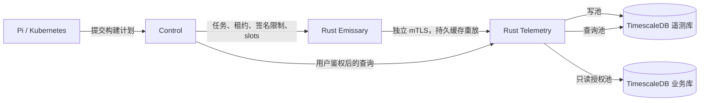

# Emissary 时序观测

所有后端使用 TimescaleDB 2.32+。默认镜像为 `timescale/timescaledb:2.32.0-pg17`，继续使用 SQLx PostgreSQL 驱动。Control、Runtime、Source 的状态表保持普通关系表；遥测使用独立逻辑数据库、写池、查询池和 Rust 服务。



## 采集范围

| 数据 | 采集与语义 |
|---|---|
| 主机资源 | 每 30 秒采集 CPU、内存、swap、Unix load、文件系统容量、网络累计计数；平台支持时记录累计磁盘 I/O |
| 托管构建进程 | 每 10 秒采集 Emissary worker 及其后代的 CPU、RSS、I/O、状态、attempt、当前 step；PID 与启动时间共同标识进程 |
| 硬件与环境 | OS、内核、架构、启动时间、CPU 型号与核数、物理内存；可读取时记录容器、虚拟化与 Linux cgroup 有效配额 |
| 工具链与构建能力 | 每 15 分钟重新执行有超时和输出上限的版本探测，更新 capability；只存签名配置的引用名称 |
| 加速器 | NVIDIA 使用有超时的 `nvidia-smi` 读取型号、驱动、VRAM、利用率；macOS 使用 `system_profiler`，Windows 使用 CIM 读取可用的显示设备身份。Apple 统一内存不作为独立 VRAM |
| 缺失与中断 | 不支持或无法读取的可选指标为 `null`，collector 状态说明采集范围；缓存淘汰、永久拒收计入累计 dropped counter；进程截断使构建汇总 `complete=false` |

不上传主机完整进程清单、进程命令行、环境变量值、工作目录或可执行文件路径。进程枚举仅在设备本地用于确认后代关系，资源计数只刷新托管进程和 Emissary 自身。硬件清单不产生 TFLOPS 或构建性能分数；工具版本探测不等同原生 SDK、签名或实际构建验收。未覆盖的 NPU、非 NVIDIA GPU 利用率保持未知。

主机 CPU 为 0–100%；进程和构建 CPU 以单个逻辑核为 100%，多核可超过 100%。磁盘、网络和进程 I/O 是累计字节计数，计算速率时应处理重启、接口变化和计数回退。RSS 汇总会重复计算共享页，不能视作主机物理内存用量。离散采样可能错过不足 10 秒的短进程。

## 数据与保留策略

| 表/视图 | 粒度 | 保留 |
|---|---|---|
| `host_samples` | 主机原始采样 | 7 天 |
| `process_samples` | PID/启动时间/attempt 原始采样 | 3 天 |
| `build_samples` | 每次采样按 attempt 汇总；缺失指标不作为零相加 | 3 天 |
| `host_minutes`, `build_minutes` | 分钟，保留有效样本数、sum、max | 30 天 |
| `host_hours`, `build_hours` | 从分钟数据按有效样本数加权 | 180 天 |

原始数据一天后进入 Hypercore 列存。保留策略按完整 chunk 删除，实际占用会包含尚未整块过期的数据。主机分钟刷新窗口为 6 天，构建为 60 小时；小时刷新窗口为 29 天。它们均短于上游保留期，避免原始数据删除后刷新把历史聚合清空。实时聚合允许读取最近尚未物化的数据，缺口不填零。

分钟 / 小时聚合覆盖主机 CPU、内存、活动 attempt，以及构建 CPU、RSS、进程数和完整性。磁盘、网络、加速器、swap、load 及逐进程 I/O 当前保留原始采样，不生成跨重启或跨设备的累计计数平均值。

静态清单存于 `inventory_versions`，每个节点与内容摘要只存一份；变化和每小时确认记录在 `inventory_observations`，保留 180 天。`latest_hosts` 与 `latest_inventories` 提供常数规模的节点摘要，乱序重放不能覆盖更新的采样。fresh 要求采样时间和接收时间都在 90 秒内，且采样时间不超过服务器 30 秒；重放旧数据不会使设备显示为新鲜。

## 传输、故障与权限

注册回复包含 `telemetry_endpoint`，使用设备现有的 pinned CA 和 mTLS 身份，连接独立端口 8444。Telemetry 每次验证证书指纹、过期和撤销；只读查询业务库确认 process attempt 属于该设备，允许已完成/已取消任务离线补报，不取得任何构建执行权。

批次有 UUID、进程内 session、单调计时、UTC 采样时间。服务器在事务提交后 ACK；节点与批次 ID 构成幂等键，内容不一致的重复 ID 被拒绝。发送端在 ACK ID 匹配后才删除本地记录。重放窗口为 48 小时；超过窗口或未来超过 5 分钟的记录永久拒收并记为缺口，需要设备修正系统时间。

独立缓存位于 `<root>/telemetry/`，默认 32 MiB、最多 8192 个记录，先淘汰最老记录；记录和丢弃计数原子落盘。主机重启后从相同 managed root 重放。构建日志配额独立。遥测超时、断联、数据库背压、磁盘写入失败均不返回构建错误；最后一种情况会记录本地告警，无法落盘的样本不保证补报。容器化 Emissary 应将 managed root 放在持久卷上。

服务器批次上限 1 MiB，单批最多 2048 个托管进程。读写和授权池分别限连接数，查询有超时、时间范围、6000 行与 2 MiB 响应预算。历史 API 返回 `{"samples":[],"truncated":false}`；`truncated=true` 时缩小时间区间。清单历史最多返回最近 100 次观察。

Control 对节点查询要求 viewer 会话，对 attempt 查询要求所属项目的 read 权限。内部查询使用独立 bearer token 和 TLS，Emissary 无该 token。生产授权连接建议使用只授予 `nodes` 与 `attempts` SELECT 权限的数据库角色；服务连接本身也设置只读模式。查询池可通过 `ARTIFACTORY_TELEMETRY_READ_DATABASE_URL` 指向专门的只读连接。

遥测用于趋势、能力筛选与负载参考。现有权限、设备签名限制、capability 和 slots 决定任务匹配；不自动抢占、预留资源或调整并发。

## 部署与本地开发

TimescaleDB 扩展由数据库管理员在创建每个数据库后安装，服务器需预加载 TimescaleDB。应用启动检查扩展版本并执行 `time_bucket` 功能检查，无需读取管理员专属配置。Telemetry 应用角色拥有遥测库及自身表，不需要 superuser。

```sql
CREATE DATABASE telemetry OWNER telemetry_role;
\connect telemetry
CREATE EXTENSION timescaledb;
```

新安装的 Compose 和主 Helm Chart 自动初始化独立遥测数据库和角色。`scripts/init-deploy.sh` / `scripts/init-helm.py` 生成独立数据库口令、服务 token 和包含遥测域名的服务证书。默认镜像和数据路径仍是 PostgreSQL 17 的 Alpine 布局，UID/GID 70。开发阶段不提供已有 PostgreSQL 卷的自动转换；本地依赖使用新命名的 `artifactory-timescaledb-test`，保留既有 PostgreSQL 容器和卷。15432 被占用时启动会明确失败。

本地先运行 `sh scripts/local-services.sh`，新生成的 `.local/env` 包含遥测配置；另开终端运行 `sh scripts/run-telemetry.sh`，再按 README 启动 Control。已有私有 env 需补齐 `ARTIFACTORY_TELEMETRY_DATABASE_URL`、`ARTIFACTORY_TELEMETRY_ENDPOINT=https://localhost:8444`、`ARTIFACTORY_TELEMETRY_URL=https://localhost:8093` 和随机的 32 字符以上 `ARTIFACTORY_TELEMETRY_TOKEN`。不要把凭证提交到仓库。

服务环境变量：`DATABASE_URL` 指向遥测库；`ARTIFACTORY_BUSINESS_DATABASE_URL` 指向只读授权连接；`ARTIFACTORY_TELEMETRY_TOKEN` 用于内部查询。`ARTIFACTORY_PKI_DIR` 包含 `ca.pem/server.pem/server.key`；HTTP 查询的 TLS 另使用 `ARTIFACTORY_SERVICE_TLS_CERT/KEY`。仅挂载这些文件，服务无需 CA 私钥。默认绑定 `127.0.0.1:8444/8093`，容器中显式绑定 `0.0.0.0`。

独立 Operator Chart 的 `telemetry.secretName` 需要上述数据库 URL 与 token，`telemetry.pkiSecretName` 引用设备 CA 签发的服务身份。它不会创建外部数据库。Control 另配置 `ARTIFACTORY_TELEMETRY_ENDPOINT`（设备可达）、`ARTIFACTORY_TELEMETRY_URL`（内部查询）和相同 token。服务证书 SAN 必须涵盖两种访问域名；Pi 的网络策略继续只允许 Source/Runtime。

## 查询与验证

通过 Control：

- `GET /api/v1/nodes/{id}/telemetry`：最新指标、清单、fresh。
- `GET /api/v1/nodes/{id}/inventory`：清单观察历史。
- `GET /api/v1/nodes/{id}/telemetry/history`：主机时序。
- `GET /api/v1/attempts/{id}/telemetry`：构建资源时序。
- `GET /api/v1/attempts/{id}/processes`：托管进程明细。

历史查询必须提供 ISO 8601 `from/to`，时间范围为左闭右开；`resolution=raw|minute|hour` 默认 minute。单次最大区间分别为 6 小时、2 天、31 天，且起点不得早于对应保留期。进程明细只支持 raw。

```sh
cargo test --locked --workspace
# 仅对隔离的、已启用 TimescaleDB 的管理员测试数据库执行：
cargo test --locked -p artifactory-telemetry-service --test database -- --ignored
python3 tests/operator/acceptance/telemetry.py --context <explicit-context> --namespace <owned-acceptance-namespace>
```

TimescaleDB 逻辑恢复应使用相同扩展版本，先安装扩展并执行 `timescaledb_pre_restore()`，串行 `pg_restore` 后执行 `timescaledb_post_restore()`；不能把遥测 dump 当作普通 PostgreSQL dump 直接并行恢复。分钟/小时物化状态、列存 chunks、后台策略和最新摘要均应纳入恢复验收。禁止将删除原始数据后的历史窗口重新全量刷新。

本次执行结果与隔离环境证据见 [2026-11-13 验收记录](acceptance/telemetry/2026-11-13.md)。
